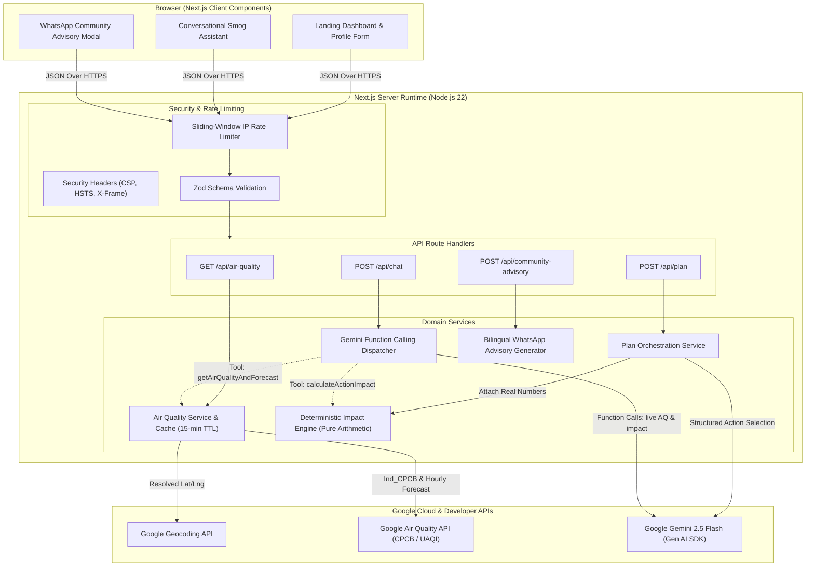

# SaafHawa (Clean Air Assistant) 🌫️🌱

> An intelligent winter smog mitigation platform for families and communities to navigate severe air quality crises with personalized low-emission daily routines, accessible indoor air quality hacks, deterministic scientific impact tracking, and WhatsApp-ready community broadcast advisories.

[](https://github.com/sirajju/saafhawa/actions/workflows/ci.yml)


---

## 📋 What the App Does

During north Indian and South Asian winters, atmospheric temperature inversions trap industrial emissions, vehicular exhaust, and biomass smoke near ground level, creating persistent hazardous smog episodes with Air Quality Index (AQI) values frequently exceeding 400.

**SaafHawa** ("Clean Air" in Hindi/Urdu) is an end-to-end assistant built for hackathons and public health defense. It combines real-time microclimate air quality data with a household's specific living profile to generate a tailored 24-hour smog survival action plan. 

### Core Pillars:
1. **Personalized 24-Hour Routine Optimization**: Recommends safe activity windows (e.g., shifting outdoor walks to midday when sunlight breaks ground inversions) and low-emission commute alternatives.
2. **Indoor Air Quality (IAQ) Defense**: Prioritizes affordable interventions—from HEPA purifiers and DIY Corsi-Rosenthal box fans to kitchen exhaust habits, door draft sealing, and wet mopping.
3. **Deterministic Scientific Impact Engine**: Calculates exact microgram ($\mu\text{g}$) inhaled $\text{PM}_{2.5}$ dose avoided and grams of $\text{PM}_{2.5}$ and $\text{CO}_2$ emissions prevented. **AI never invents or guesses numbers.**
4. **Conversational Assistant with Function Calling**: Users can ask natural follow-up questions (*"Can my daughter play soccer outside at 5 PM?"*, *"How much cleaner is the metro?"*). Gemini executes registered backend tools to fetch live conditions and run arithmetic models.
5. **WhatsApp Community Advisories**: Generates one-click, formatted broadcast advisories in **English** and **Hindi** tailored for Housing Societies (RWAs) and School/Parent groups.

---

## 🎯 Problem Statement Coverage Matrix

| Hackathon Requirement | SaafHawa Implementation | Technical Enforcement |
| :--- | :--- | :--- |
| **Severe Winter Smog Focus** | Micro-targeted air quality data using India's National AQI (`ind_cpcb`) and 24-hour hourly forecast curves. | Google Air Quality API + 15-minute capped TTL cache. |
| **Routines Based on Location & Living** | 21-action verified catalogue evaluated against household composition (children, seniors, asthma), commute distance, fuels, and budget. | Zod schema validation on profile + Gemini structured action selection. |
| **Indoor Air Quality Hacks** | Actions for DIY Corsi-Rosenthal box fans, HEPA bedroom filtration, kitchen exhaust venting, eliminating incense/coils, wet mopping. | Deterministic indoor particulate mass-balance equations. |
| **Clear Impact of Each Choice** | Every card visualizes avoided inhaled $\mu\text{g}$ dose and emissions saved, translated to relatable benchmarks (e.g., cigarette equivalents avoided, car-km prevented). | Pure TypeScript calculator (`src/lib/impact/calculator.ts`) grounded in peer-reviewed science. |
| **No Client-Exposed API Keys** | All Google Geocoding, Air Quality, and Gemini requests execute strictly on the server runtime. | Zero `NEXT_PUBLIC_` secrets; keys loaded only in route handlers and server services. |
| **Interactive Follow-ups** | Context-aware chat panel with Gemini function calling and strict medical disclaimers. | Multi-turn `@google/genai` tool use with factual fallbacks. |
| **Community Scaling** | Pre-formatted WhatsApp advisories in English & Hindi for housing societies & schools. | Modal with copy-to-clipboard and WhatsApp deep link (`https://api.whatsapp.com/send`). |
| **Accessibility & Performance** | Calm visual design, high contrast, text-first AQI categories (never color alone), full keyboard navigation, screen reader labels. | Strict semantic HTML, WCAG AA compliance, responsive mobile layout. |

---

## 🏗️ Architecture & Data Flow



---

## 🌐 Google Services Used & Why

| Service | Why We Selected It | Implementation Detail |
| :--- | :--- | :--- |
| **Google Geocoding API** | Accurately resolves Indian 6-digit postal pincodes (e.g., `110001`, `560001`), colloquial area names, and landmarks into precise coordinates. | Cached on the server; handles input normalization and location bounds. |
| **Google Air Quality API** | Provides both India's official Central Pollution Control Board scale (`ind_cpcb`, 0–500) and Universal AQI (`uaqi`), dominant pollutant identification, real-time $\text{PM}_{2.5}$/$\text{PM}_{10}$ concentrations, and 24-hour hourly forecast curves. | Requests an explicit 24-hr `dateTime` window; falls back to current conditions if forecast lookup times out. |
| **Google Gemini 2.5 Flash (`@google/genai`)** | Ultra-low latency, cost-effective multimodal LLM with native support for structured JSON schema outputs (`responseSchema`) and multi-turn function calling. | **Two Distinct Roles**: <br>1. *Action Planning*: Returns only 6–8 curated action IDs and timing rationales without numerical guessing.<br>2. *Chat Assistant*: Grounded via function calling (`getAirQualityAndForecast`, `calculateActionImpact`, `listCatalogueActions`). |
| **Google Cloud Run** | Fully managed serverless container runtime that scales to zero, handles automated TLS termination, and runs Next.js standalone output efficiently in the `asia-south1` (Mumbai) region. | Packaged using a multi-stage Dockerfile running non-root `nextjs` user on port 8080. |

---

## 🔬 Scientific Impact Factors & Literature Sources

All mathematical equations in `src/lib/impact/calculator.ts` and baseline coefficients in `src/lib/impact/factors.ts` are cited from peer-reviewed journals, national standards, or environmental agencies:

| Impact Constant / Parameter | Value Used | Published Scientific Source |
| :--- | :--- | :--- |
| **Resting Inhalation Rate (Adult)** | $0.45\text{ m}^3/\text{hr}$ | **US EPA Exposure Factors Handbook (2011)**, Table 6-1. |
| **Light Domestic Inhalation Rate** | $0.60\text{ m}^3/\text{hr}$ | **US EPA Exposure Factors Handbook (2011)**, Table 6-1. |
| **Child Inhalation Rate (Age 6–11)** | $0.42\text{ m}^3/\text{hr}$ | **US EPA Child-Specific Exposure Factors Handbook (2008)**, Ch. 6. |
| **Senior Inhalation Rate (>65 yrs)** | $0.52\text{ m}^3/\text{hr}$ | **US EPA Exposure Factors Handbook (2011)**, Table 6-1. |
| **Real-World N95 Mask Protection** | $85\%$ effective | **MacIntyre et al., BMJ (2009)**; CDC/NIOSH fit-testing adjustments. |
| **HEPA Air Purifier Efficiency** | $75\%$ reduction | **US EPA (EPA 402-F-08-004)** "Residential Air Cleaners" & CPCB clean room metrics. |
| **DIY Corsi-Rosenthal Box Clean Air Rate** | $68\%$ reduction | **Rosenthal, J. & Corsi, R., UC Davis (2021)** "Corsi-Rosenthal Box Air Cleaner Testing". |
| **Closed-Window Baseline Infiltration** | $0.50$ ($I/O$ ratio) | **Lawrence Berkeley National Laboratory (LBNL-44933)**; Chen & Zhao, *Atmospheric Environment (2011)*. |
| **Kitchen Cooking $\text{PM}_{2.5}$ Spike** | $250.0\ \mu\text{g}/\text{m}^3$ | **Pant, P. et al., Atmospheric Environment (2016)** "Indoor PM in Indian Homes". |
| **Kitchen Exhaust Capture Rate** | $70\%$ capture | **Singer, B. C. et al., Lawrence Berkeley National Lab (2012)** *Atmospheric Environment*. |
| **Wet Mopping Resuspension Prevention**| $25.0\ \mu\text{g}/\text{m}^3$ | **WHO Guidelines for Indoor Air Quality** & CPCB domestic dust studies. |
| **Incense / Mosquito Coil $\text{PM}_{2.5}$** | $0.035\text{ g/stick}$ ($180\ \mu\text{g}/\text{m}^3$) | **Liu, W. et al., Environmental Health Perspectives / Chest (2003)**. |
| **Petrol Car Emissions** | $150\text{ g CO}_2/\text{km}$, $0.045\text{ g PM}_{2.5}/\text{km}$ | **ARAI (Automotive Research Association of India)** & **TERI (2021)**. |
| **Diesel Car Emissions** | $145\text{ g CO}_2/\text{km}$, $0.070\text{ g PM}_{2.5}/\text{km}$ | **ARAI** & **CPCB In-Use Vehicle Emission Factors**. |
| **Delhi Metro Transit Factor** | $18\text{ g CO}_2/\text{p-km}$, $0.001\text{ g PM}_{2.5}/\text{p-km}$ | **Delhi Metro Rail Corporation (DMRC) Annual Sustainability Report (2022)**. |
| **Traditional Chulha Biomass Cooking**| $34\text{ g PM}_{2.5}/\text{day}$, $6.0\text{ kg CO}_2/\text{day}$ | **WHO Guidelines for Indoor Air Quality: Household Fuel Combustion (2014)**; IPCC 2006. |
| **Residential Leaf / Garden Burning** | $25.0\text{ g PM}_{2.5}/\text{kg}$, $1.25\text{ kg CO}_2/\text{kg}$ | **US EPA AP-42 (Section 2.5 Open Burning)** & CPCB Source Apportionment. |
| **Cigarette Inhaled Particulate Equiv**| $1\text{ cig} \approx 180\ \mu\text{g}\ \text{PM}_{2.5}$ | **Berkeley Earth Air Quality & Cigarette Inhalation Equivalence Studies**. |

---

## 🔒 Security & Production Hardening

- **Zero Client Credential Exposure**: API keys (`GOOGLE_MAPS_API_KEY`, `GEMINI_API_KEY`) are read strictly on the server side. No sensitive environment variables use the `NEXT_PUBLIC_` prefix.
- **Rate Limiting Across All Routes**:
  - `GET /api/air-quality`: 60 requests / min / IP
  - `POST /api/plan`: 30 requests / min / IP
  - `POST /api/chat`: 15 requests / min / IP
  - `POST /api/community-advisory`: 20 requests / min / IP
- **Security Headers Enabled (`next.config.ts`)**:
  - `Content-Security-Policy`: Strictly scopes script, style, image, and connect origins.
  - `X-Frame-Options: DENY`: Blocks clickjacking and frame embedding.
  - `X-Content-Type-Options: nosniff`: Prevents MIME-type sniffing.
  - `Strict-Transport-Security`: Enforces HTTPS (`max-age=63072000; includeSubDomains; preload`).
  - `Referrer-Policy: origin-when-cross-origin`.
  - `Permissions-Policy`: Disables unused camera, microphone, and geolocation hardware.
- **Input Sanitization & Error Masking**:
  - Zod schemas validate length, types, and allowed enumeration on all endpoints.
  - Raw upstream provider error traces and internal stack details are scrubbed before sending client responses.
- **Medical Disclaimer Guardrail**:
  - Conversational assistant is strictly forbidden from diagnosing symptoms or altering prescriptions. For health inquiries, it offers immediate environmental precautions (HEPA filtration, sealed room) and advises consulting a qualified doctor.

---

## 📁 Repository Structure

```
.
├── .env.example                     # Environment variables template
├── .github/
│   └── workflows/
│       └── ci.yml                   # Automated CI: lint, typecheck, vitest & playwright
├── Dockerfile                       # Multi-stage production container for Cloud Run
├── .dockerignore                    # Excluded files for lean Docker build context
├── eslint.config.mjs                # ESLint flat configuration
├── next.config.ts                   # Next.js standalone output & security headers
├── package.json                     # Project scripts and pinned dependencies
├── playwright.config.ts             # Playwright E2E configuration & webServer
├── tsconfig.json                    # Strict TypeScript configuration
├── vitest.config.mts                # Vitest configuration with JSDOM
├── e2e/
│   └── smoke.spec.ts                # Playwright smoke test (Onboarding to Dashboard)
└── src/
    ├── app/
    │   ├── api/
    │   │   ├── air-quality/route.ts # GET /api/air-quality (CPCB/UAQI with rate-limiting)
    │   │   ├── chat/route.ts        # POST /api/chat (Gemini function calling)
    │   │   ├── community-advisory/  # POST /api/community-advisory (WhatsApp broadcast)
    │   │   └── plan/route.ts        # POST /api/plan (Hybrid AI + impact calculator)
    │   ├── globals.css              # Tailwind CSS imports & global base styles
    │   ├── layout.tsx               # Root layout & meta tags
    │   └── page.tsx                 # Main application dashboard & state manager
    ├── components/
    │   ├── AirQualityCard.tsx       # Live AQI gauge, pollutant levels & hourly forecast
    │   ├── ChatPanel.tsx            # Follow-up conversational assistant UI
    │   ├── CommunityAdvisoryModal.tsx # Bilingual WhatsApp advisory generator modal
    │   ├── LoadingState.tsx         # Accessible skeleton loader
    │   ├── Navbar.tsx               # Header with location, refresh & community share
    │   ├── OnboardingForm.tsx       # Accessible profile setup form (saved in localStorage)
    │   ├── PlanCard.tsx             # Action intervention cards with plain-language metrics
    │   └── TotalSavingsBanner.tsx   # Cumulative daily avoided dose & emission savings
    ├── lib/
    │   ├── air-quality/             # Google Maps Geocoding & Air Quality client + cache
    │   ├── chat/                    # Function declarations, tools & Gemini loop
    │   ├── community/               # English & Hindi WhatsApp advisory templates
    │   ├── impact/                  # Deterministic arithmetic calculator & factor science
    │   ├── plan/                    # Hybrid plan orchestration & fallback rules
    │   └── rate-limit.ts            # Sliding-window IP rate limiter
    └── test/                        # Vitest unit & integration test suites
        ├── air-quality.test.ts      # Air quality caching, Google client & route tests
        ├── chat-tools.test.ts       # Function-calling tools, rate limiting & safety tests
        ├── impact.test.ts           # Pure arithmetic calculator unit tests
        └── plan.test.ts             # Plan prompt builder, validation & fallback tests
```

---

## 🚀 Getting Started

### 1. Prerequisites
- **Node.js**: `v20.x` or `v22.x` (LTS recommended)
- **npm**: `v10.x` or higher
- **Google Cloud API Key** with access to:
  - Google Maps Geocoding API
  - Google Air Quality API
- **Google Gemini API Key** (from [Google AI Studio](https://aistudio.google.com/))

### 2. Installation
```bash
# Clone the repository
git clone https://github.com/sirajju/saafhawa.git
cd saafhawa

# Install dependencies cleanly
npm install
```

### 3. Environment Configuration
Copy the template and configure your server-side keys:
```bash
cp .env.example .env.local
```

Edit `.env.local`:
```env
GOOGLE_MAPS_API_KEY=your_google_maps_platform_api_key_here
GEMINI_API_KEY=your_gemini_api_key_here
GEMINI_MODEL=gemini-2.5-flash
```

### 4. Running Locally
```bash
npm run dev
```
Open [http://localhost:3000](http://localhost:3000) in your browser.

---

## 🧪 Testing & Quality Assurance

### Run Unit Tests (Vitest)
Executes all 67 comprehensive unit and integration tests across the arithmetic calculator, air quality service, Gemini prompts, and rate limiters:
```bash
npm test
```
To run tests in watch mode during development:
```bash
npm run test:watch
```

### Run End-to-End Smoke Tests (Playwright)
Validates the complete user journey (onboarding form, localStorage caching, dashboard rendering, real-time cards, action groups, and chat panel) with deterministic API mocks:
```bash
# Install Playwright browser binary (first time only)
npx playwright install chromium

# Build and run the headless smoke test
npm run build
npm run test:e2e
```

### Code Style & Type Safety
```bash
# Run ESLint check
npm run lint

# Run strict TypeScript compilation check
npx tsc --noEmit
```

---

## ☁️ Deployment to Google Cloud Run

SaafHawa uses Next.js `output: 'standalone'` to compile a minimal Node.js server container image without bloated build tools or dev dependencies.

### Step 1: Set Google Cloud Project
```bash
gcloud config set project YOUR_GCP_PROJECT_ID
```

### Step 2: Build & Push Container Image
Using Google Cloud Build:
```bash
gcloud builds submit --tag gcr.io/YOUR_GCP_PROJECT_ID/saafhawa:latest
```

### Step 3: Deploy to Cloud Run
Deploy with serverless scaling and environment secrets:
```bash
gcloud run deploy saafhawa \
  --image gcr.io/YOUR_GCP_PROJECT_ID/saafhawa:latest \
  --platform managed \
  --region asia-south1 \
  --allow-unauthenticated \
  --port 8080 \
  --memory 1Gi \
  --cpu 1 \
  --set-env-vars "NODE_ENV=production,GEMINI_MODEL=gemini-2.5-flash" \
  --set-secrets "GOOGLE_MAPS_API_KEY=GOOGLE_MAPS_API_KEY:latest,GEMINI_API_KEY=GEMINI_API_KEY:latest"
```

---

## 📜 License & Acknowledgments

Built for good during winter smog crises. All calculations are released under the MIT License for public health and civic technology applications.
