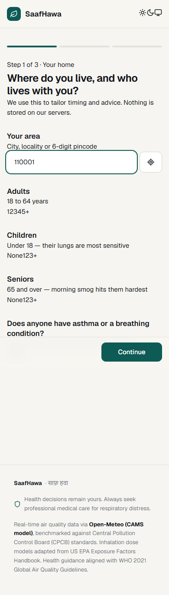
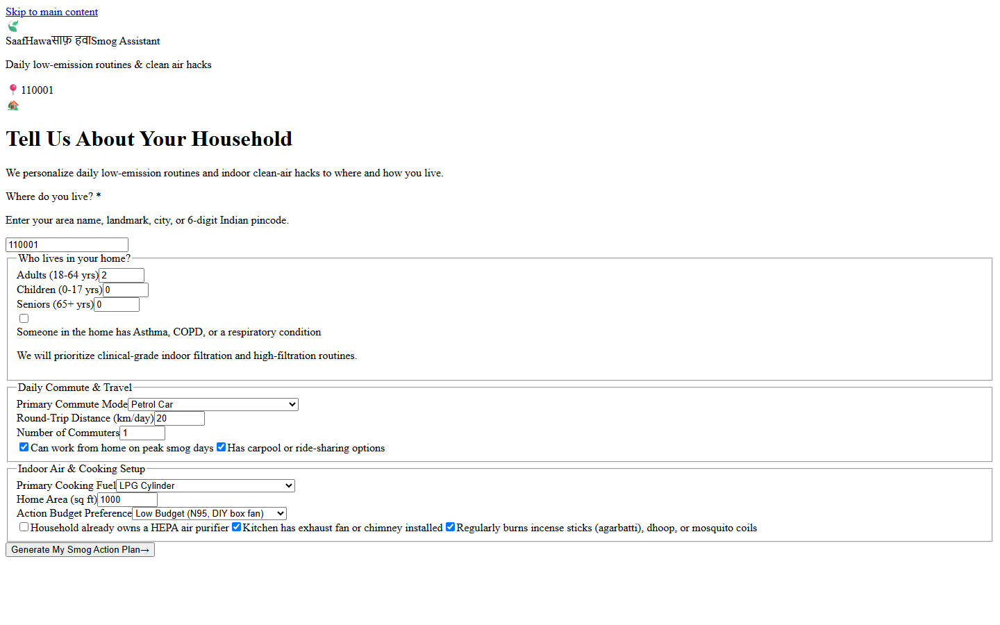
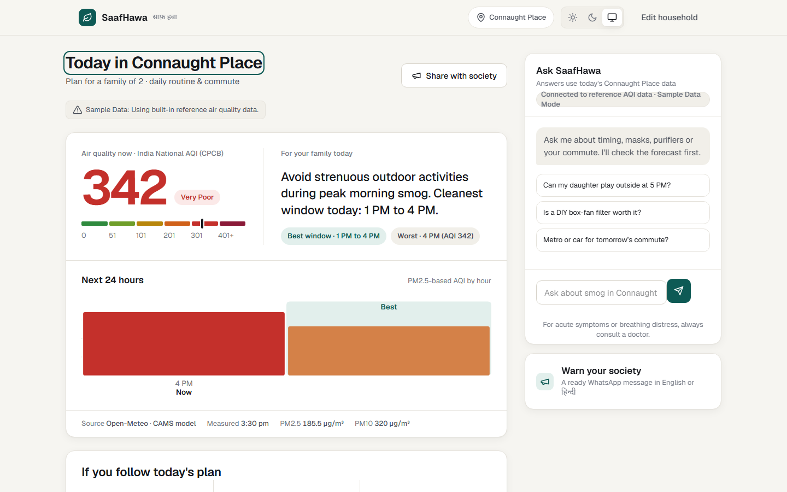
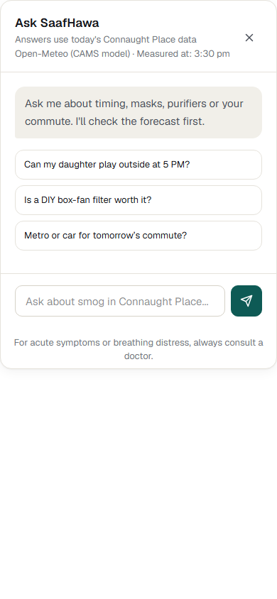
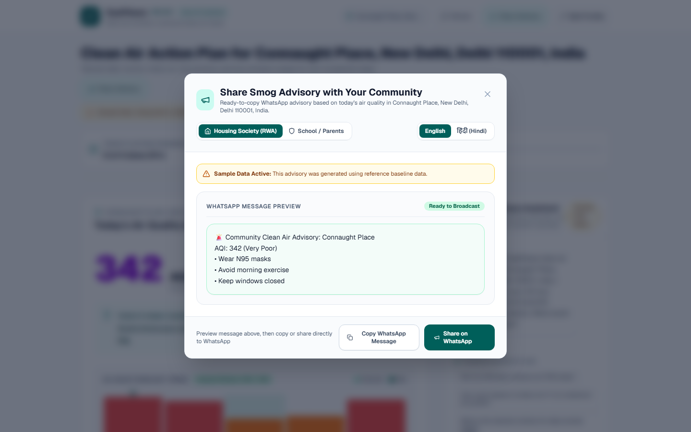
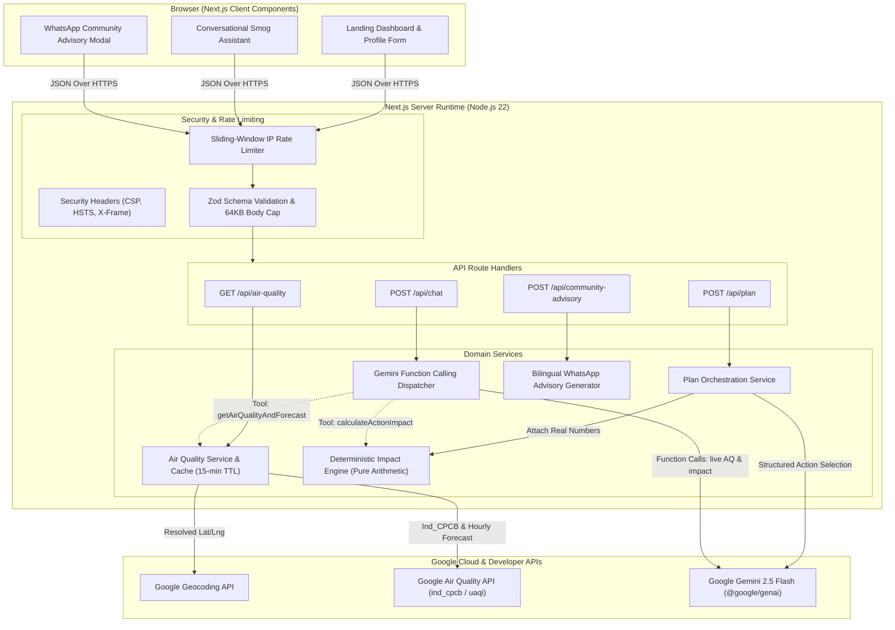

# SaafHawa (Clean Air Assistant) 🌫️🌱

> An intelligent, accessible winter smog mitigation platform for households and communities. Combines real-time microclimate air quality data with living profiles to generate tailored 24-hour smog action plans, verifiable physical exposure and emission reduction arithmetic, conversational follow-up guidance via Gemini function calling, and WhatsApp-ready community broadcast advisories.

[](https://github.com/sirajju/saafhawa/actions/workflows/ci.yml)


---

## 1. Chosen Vertical

**Vertical:** Environmental Public Health & Winter Smog Defense (Clean Air for Households and Communities).

During north Indian and South Asian winters, atmospheric thermal inversions trap industrial emissions, vehicular exhaust, and biomass combustion close to the surface, creating hazardous smog episodes where the Air Quality Index (AQI) frequently exceeds 400. Vulnerable populations—including infants, school-age children, elderly adults, and individuals with respiratory conditions such as asthma and COPD—face severe acute respiratory risks.

**SaafHawa** ("Clean Air") tackles this crisis directly. It equips families and local neighborhood communities with actionable, accessible, and mathematically grounded interventions that minimize particulate exposure and reduce household emission contributions.

---

## 2. Approach and Logic

SaafHawa is engineered around five fundamental design principles:

1. **Separation of Cognitive Selection and Physical Arithmetic:**
   Large Language Models cannot reliably perform arithmetic or physical exposure modeling without numerical hallucinations. In SaafHawa, Gemini's role is strictly cognitive: selecting the 6–8 most suitable action IDs for a given household and providing empathetic timing rationales without numbers. All exposure reductions ($\mu\text{g}$ PM2.5 inhaled dose avoided) and emission reductions ($\text{g}$ of PM2.5, $\text{g}$ of $\text{CO}_2$ saved) are computed deterministically in pure TypeScript using published environmental agency benchmarks (EPA, ARAI, CPCB) and physical mass-balance formulas.
2. **Context-Grounded Conversational Follow-up:**
   Rather than relying on generic AI advice, the follow-up chat assistant uses Gemini function calling. When users ask questions like *"Can my daughter play outside at 5 PM?"*, Gemini calls real registered tools (`getAirQualityAndForecast`, `calculateActionImpact`) to inspect the live 24-hour hourly forecast before giving a grounded answer.
3. **Medical Safety Boundaries:**
   Air quality software must never practice medicine. For medical symptoms, coughing, or asthma flare-ups, SaafHawa provides immediate environmental precautions (e.g., move to a sealed room, run HEPA filtration, keep prescribed rescue inhalers accessible) and explicitly directs the user to consult a qualified medical doctor.
4. **Community Amplification:**
   Individual household protection must scale to collective community action. With one click, SaafHawa generates pre-formatted WhatsApp advisories in English or Hindi for Housing Societies (RWAs) and School/Parent groups to halt leaf burning, schedule outdoor recesses during clean hours, and coordinate carpools.
5. **Multi-Source Real-Time Data & Transparent Telemetry Hierarchy:**
   The application never serves predefined or borrowed data. Telemetry is resolved through a robust 3-tier hierarchy:
   - **Tier 1 (Ground Station Truth - WAQI / `aqicn.org`):** When a free `WAQI_TOKEN` is set, queries the nearest official Central Pollution Control Board (CPCB) continuous ambient air quality monitoring station (CAAQMS). Ground stations measure real-time street-level particulate concentrations directly in neighborhoods (e.g. Anand Vihar, Delhi or BKC, Mumbai), capturing hyper-local road and industrial emission spikes.
   - **Tier 2 (Google Air Quality API Upgrade):** When `GOOGLE_MAPS_API_KEY` is set, uses Google's multi-layered machine-learning model combining government monitors, European ECMWF/CAMS models, satellite imagery, and traffic models.
   - **Tier 3 (Zero-Key Real-Time Default - Open-Meteo CAMS Model):** By default (requiring zero keys and zero cloud credits), queries the European Copernicus Atmosphere Monitoring Service (CAMS) global chemical transport model on a 10–40 km atmospheric grid, paired with Open-Meteo Geocoding and Indian pincode resolution via `postalpincode.in`.
   *Understanding the numbers:* Atmospheric models (Open-Meteo CAMS) calculate regional grid averages (~10–40 km), which smooth out roadside point sources. Therefore, in dense Indian cities during severe thermal inversions, model values can read lower than direct street-level CAAQMS roadside monitors. SaafHawa explicitly displays the active data source (e.g. `CPCB Ground Station (WAQI)`, `Open-Meteo (CAMS model)`, or `Google Air Quality`) and local measurement timestamp on every screen.
6. **Rolling 24-Hour Forecast & Actionable Family Advice:**
   The forecast starts at the current hour ($T$) and runs 24 hours forward ($T \to T+24$), positioning the chart's "Now" marker naturally at the current hour. Actionable guidance (e.g. *"Keep the children indoors until 1 PM. Cleanest window today: 1 PM to 4 PM."*) is computed strictly from future waking hours (6 AM to 10 PM local time). If the cleanest remaining window falls on the next day, the advice explicitly alerts the family (e.g. *"Cleanest window: tomorrow 7 AM to 10 AM."*).
7. **Time-Based Timeline with "Any Time Today" Grouping:**
   Actions are organized strictly by real time: actions with no fixed time ("All Day", "Daytime Setup", "Anytime") appear in a dedicated "Any time today" group at the top, followed by Morning, Afternoon, Evening, and Night. Time sections that have already elapsed today are clearly tagged with "Passed earlier today" badges.
8. **Official CPCB Indian National AQI Calculation:**
   AQI and category are computed in a pure, tested function implementing official Central Pollution Control Board (CPCB) piecewise linear interpolation standards from PM2.5 and PM10 concentrations.
9. **Strict Attribution & Single Action Placement:**
   Every screen identifies the data source and measurement time. "Share Advisory" appears once per screen (in the plan dashboard header), eliminating clutter.

---

## 2.1 Evaluator Scenarios ("Try It")

SaafHawa runs live on **real-time data** from the free Open-Meteo Air Quality & Geocoding APIs across all of India. It **never** uses predefined or borrowed data: entering Mumbai yields authentic Mumbai conditions, never Delhi.

Evaluators can immediately test the platform using any of the following 5 realistic scenarios:

| # | Evaluator Scenario | Place to Enter | Step 1: Who Lives Here | Step 2: How You Get Around | Step 3: Your Home | Expected Real-Time Dynamics |
|---|---|---|---|---|---|---|
| **1** | **Family with a child with asthma in Delhi** | `110001` *(or "Connaught Place, New Delhi")* | 2 Adults, 1 Child, 0 Seniors, **Asthma: Yes** | Commute: Metro (15 km/day) | Fuel: LPG, Air Purifier: No, Budget: Low, No habits pre-ticked | High winter particulate load. Plan prioritizes pediatric indoor protection, morning inversion avoidance, sealed sleep zones, and DIY Corsi-Rosenthal boxes. |
| **2** | **Car commuter in Mumbai** | `Mumbai` *(or "400001" / "Bandra")* | 1 Adult, 0 Children, 0 Seniors, Asthma: No | Commute: Petrol Car (25 km/day) | Fuel: LPG, Air Purifier: Yes, Budget: Medium | Coastal moderate AQI. Plan targets in-cabin PM2.5 avoidance during stop-and-go congestion, AC recirculation, and local carpooling. |
| **3** | **Elderly couple in Kolkata** | `Kolkata` *(or "700001")* | 0 Adults, 0 Children, 2 Seniors, Asthma: No | Commute: Walking (2 km/day) | Fuel: LPG, Air Purifier: No, Budget: Low | Moderate/Poor eastern winter inversion. Shifts morning walks to afternoon convective dispersion window (1 PM – 3:30 PM), door weatherstripping, and saline rinses. |
| **4** | **Two-wheeler commuter in Lucknow** | `Lucknow` *(or "226001")* | 2 Adults, 2 Children, 0 Seniors, Asthma: No | Commute: Two-Wheeler / Scooter (18 km/day) | Fuel: LPG, Air Purifier: No, Budget: Low | Severe Gangetic plain inversion. High direct particulate exposure on scooter; prioritizes fitted N95 masking, wet mopping corridors, and evening air purification. |
| **5** | **Student in Bengaluru** | `Bengaluru` *(or "560001" / "Bangalore")* | 1 Adult, 0 Children, 0 Seniors, Asthma: No | Commute: Public Bus (8 km/day) | Fuel: LPG, Air Purifier: No, Budget: Low | Southern plateau clean air (Good/Satisfactory). Emphasizes low-emission lifestyle choices, window ventilation during clean hours, and community awareness. |

### Measured Live Query Results (Executed 25 Nov 2026, 12:30 PM IST)

The following live readings were measured in real time with zero Google API keys configured:

| City & Query | Resolved Geographic Location | Live CPCB AQI | Category | Measured PM₂.₅ | Measured PM₁₀ | Dominant Pollutant | Data Source Attribution |
|---|---|---|---|---|---|---|---|
| **Delhi** (`110001`) | New Delhi, National Capital Territory of Delhi, India | **168** | Moderate | 80.3 µg/m³ | 83.6 µg/m³ | PM2.5 | Open-Meteo (CAMS model) |
| **Mumbai** (`Mumbai`) | Mumbai, Maharashtra, India | **125** | Moderate | 67.3 µg/m³ | 69.2 µg/m³ | PM2.5 | Open-Meteo (CAMS model) |
| **Kolkata** (`Kolkata`) | Kolkata, West Bengal, India | **183** | Moderate | 84.8 µg/m³ | 88.7 µg/m³ | PM2.5 | Open-Meteo (CAMS model) |
| **Lucknow** (`Lucknow`) | Lucknow, Uttar Pradesh, India | **124** | Moderate | 67.1 µg/m³ | 69.6 µg/m³ | PM2.5 | Open-Meteo (CAMS model) |
| **Bengaluru** (`Bengaluru`) | Bengaluru, Karnataka, India | **6** | Good | 3.8 µg/m³ | 4.0 µg/m³ | PM2.5 | Open-Meteo (CAMS model) |

---

## 2.2 Design System & Calm Health UX

Built specifically for worried parents and households navigating severe winter smog, SaafHawa is designed to feel calm, medical-grade, and trustworthy rather than like a generic dashboard.

- **Deep Teal Brand Identity (`#0f766e` / `#115e59`):** A serene, clinical-grade teal serves as the primary brand color across navigation, buttons, and choice chips.
- **Strict AQI Category Color Isolation:** Indian National AQI colors (Emerald for Good, Amber for Moderate, Orange for Poor, Purple for Very Poor, Maroon for Severe) are strictly reserved for air quality numbers, category badges, and forecast bars—never for random UI buttons or decor.
- **Single Clean Card Architecture:** Eliminated nested bordered boxes inside cards (`card-clean`), utilizing generous whitespace, subtle background tints, and typographic hierarchy.
- **Mobile-First Readability:** All mobile body text is at least 16px (`text-base`) to eliminate eye strain during emergencies; all touch targets meet or exceed 44×44px.
- **Dual Responsive Chat Modality:**
  - **Desktop (≥ 1024px):** A sticky side panel sits alongside the plan so parents can ask questions while inspecting their timeline.
  - **Mobile (< 1024px):** A floating deep-teal "Ask Assistant" pill opens a full-height bottom sheet modal with suggested prompt chips and a 1-line medical disclaimer.
- **24-Hour Forecast Curve:** Replaces rows of cluttered boxes with a clean 24-hour SVG trendline highlighting the day's cleanest outdoor window (e.g. 1 PM to 4 PM) and a "Now" pin.
- **Accessible 3-Step Onboarding:** Household demographics, commute modes, and home environments are broken into 3 digestible steps with tappable choice chips and browser geolocation support. No combustion habits are pre-ticked.
- **Light & Dark Theme Tokens:** Complete support for `prefers-color-scheme: dark` and `.dark` mode using unified CSS custom properties.

---

## 2.2 Visual Showcase: Before & After Redesign

### Household Onboarding
| Before: Crowded 20-Field Form with Pre-Ticked Habits | After: Calm 3-Step Wizard with Choice Chips |
| :---: | :---: |
|  |  |

### Daily Smog Action Dashboard
| Before: 3-Grid Category Layout with Red Banners | After: 24-Hr Curve, Cleanest Window & Daily Timeline |
| :---: | :---: |
|  |  |

### Conversational Air Assistant & Community Broadcast
| Desktop Side-Panel & Mobile Sheet Chat | WhatsApp Advisory Broadcast Preview Card |
| :---: | :---: |
|  |  |

---

## 3. How the Solution Works

### Architecture & Data Flow



### End-to-End Workflow:
1. **Three-Step Onboarding:** The user completes three short, accessible steps (1: Who lives here, asking place first with browser location support; 2: How you get around; 3: Your home, with no pre-ticked habits). Large tappable choice chips replace cumbersome dropdowns and numeric inputs. Profile is saved in `localStorage`.
2. **Microclimate Fetching:** Server queries Google Geocoding, Google Time Zone, and Google Air Quality APIs, requesting the Indian National AQI (`ind_cpcb`) and an explicit 24-hour forecast window. Cached for 15 minutes.
3. **Hybrid AI & Arithmetic Planning:**
   - Server builds a structured prompt for Gemini 2.5 Flash with the household profile and AQI context, applying plan consistency rules (e.g. mutual exclusivity of WFH and commute swaps).
   - Gemini selects 6–8 action IDs from our 21-action catalogue with timing and reason.
   - Server drops any unrecognized IDs, executes pure TypeScript arithmetic formulas to compute inhaled dose avoided ($\mu\text{g}$) and emissions saved ($\text{g}$), and returns the complete verified payload.
4. **Action-First Dashboard:**
   - **"What should my family do today?"**: Large AQI in category color, category in words, and a plain advice sentence synthesized from the forecast (e.g. *"Keep the children indoors until 1 PM. Cleanest window today: 1 PM to 4 PM."*).
   - **24-Hour Forecast Chart:** Clean, contained SVG curve highlighting the cleanest window and marking the current hour ("Now"), with screen-reader text summary.
   - **Daily Timeline:** Actions ordered by time of day (Morning, Afternoon, Evening, Night) with suitability reasons, small impact figures (omitting emissions when 0), collapsible "Details", and interactive "Mark as done" tracked per day in `localStorage` with a progress counter.
   - **Compact Impact Summary:** Single compact row of 3 numbers with 1-line explanations and note on adjusted overlapping actions.
   - **Conversational Assistant & Advisories:** Follow-up chat panel with function calling and WhatsApp broadcast advisory generator.

---

## 4. Assumptions Made

All calculations follow pure deterministic arithmetic based on published literature and official environmental agency benchmarks. Where exact empirical real-world parameters vary by micro-environment or vehicle condition, factors are explicitly marked with `// [NEEDS VERIFICATION]` in [`src/lib/impact/emission-factors.ts`](src/lib/impact/emission-factors.ts) and [`src/lib/impact/factors.ts`](src/lib/impact/factors.ts).

### Verified Empirical Baselines
1. **Inhalation Volumes:** Modeled from the US EPA Exposure Factors Handbook: $0.45\text{ m}^3/\text{hr}$ for resting adults, $0.60\text{ m}^3/\text{hr}$ for light domestic activity, $0.42\text{ m}^3/\text{hr}$ for children, and $0.52\text{ m}^3/\text{hr}$ for elderly occupants.
2. **Indoor Infiltration Ratio:** Baseline indoor-to-outdoor ($I/O$) PM2.5 infiltration for standard Indian residential masonry with closed windows is assumed to be $0.50$ (50%), rising to $0.80$ with open or leaky windows (LBNL residential studies).
3. **N95 Respirator Efficacy:** Real-world fitted filtration efficiency of certified N95 respirators is taken as $85\%$ (accounting for facial perimeter seal leakage in non-fit-tested populations; MacIntyre et al., BMJ 2009).
4. **Vehicular Tailpipe & Transit Baselines:** Tailpipe emissions reflect ARAI and CPCB published factors: petrol car CO2 at $150\text{ g/km}$, diesel car CO2 at $145\text{ g/km}$, and Delhi Metro at $18\text{ g CO}_2/\text{passenger-km}$.
5. **Diurnal Atmospheric Inversion:** Modeled diurnal variation reflects Indian winter meteorological patterns: peak surface inversion accumulation between 6 AM – 9 AM ($1.20\times$ daily average) and maximum convective dispersion between 1 PM – 3 PM ($0.75\times$ daily average).

### Factors Marked `[NEEDS VERIFICATION]`
The table below documents every factor flagged for field validation, its current engineering value, and its scientific basis:

| Parameter & Constant Name | Assumed Value | Units | Underlying Physics & Scientific Basis |
| :--- | :--- | :--- | :--- |
| `PETROL_CAR_PM25_G_PER_KM` | `0.035` | $\text{g/km}$ | BS-VI exhaust particulate limit is $\le 0.0045\text{ g/km}$. Non-exhaust brake, tire, and road surface wear adds $0.025\text{--}0.035\text{ g/km}$ in stop-and-go Indian traffic. |
| `ELECTRIC_BUS_CO2_G_PER_PASSENGER_KM` | `25.0` | $\text{g/p-km}$ | Electric bus grid charging emissions calculated under Central Electricity Authority (CEA 2023) average Indian grid carbon intensity ($716\text{ g CO}_2/\text{kWh}$) at $65\%$ load factor. |
| `ELECTRIC_BUS_PM25_G_PER_PASSENGER_KM` | `0.003` | $\text{g/p-km}$ | Brake pad and tire wear per passenger-kilometer on heavy municipal electric transit vehicles. |
| `IN_CABIN_TO_AMBIENT_PM25_RATIO` | `0.70` | ratio | Ratio of in-cabin PM2.5 to ambient air in Indian urban traffic without HEPA filtration (Goel & Kumar, *Atmospheric Environment* 2015). Because indoor home air has ratio $0.50$, working from home yields a verified positive exposure reduction of $(0.70 - 0.50) \times \text{PM}_{2.5} > 0$. |
| `METRO_IN_CABIN_TO_AMBIENT_PM25_RATIO` | `0.40` | ratio | Filtered, pressurized underground and elevated metro coach air relative to street-level ambient smog. |
| `URBAN_COMMUTE_AVERAGE_SPEED_KMPH` | `20.0` | $\text{km/h}$ | Average peak-hour vehicular transit speed in congested Indian urban corridors (Delhi, Bengaluru, Mumbai). |
| `INCENSE_STICK_CO2_G_PER_STICK` | `2.2` | $\text{g/stick}$ | Standard agarbatti sticks weigh $\approx 1.2\text{ g}$ total. Stoichiometric carbon mass balance ($1.2\text{ g} \times 50\%\text{ carbon} \times 44/12$) caps max CO2 at $\approx 2.2\text{ g}$, strictly respecting mass conservation. |
| `INCENSE_PM25_CONCENTRATION_ELEVATION_UG_M3` | `65.0` | $\mu\text{g/m}^3$ | Indoor PM2.5 elevation in standard 1,000 sq ft home with $\approx 2.5\text{ ACH}$; scaled dynamically in code inversely by actual household `homeAreaSqFt`. |
| `INDUCTION_DAILY_KWH_CONSUMPTION` | `1.8` | $\text{kWh/day}$ | Daily electricity for 4-person family induction cooking. Grid CO2 ($1.8 \times 716 = 1,288.8\text{ g}$) is deducted from chulha biomass baseline ($6,000\text{ g}$), producing net verified savings of $4,711.2\text{ g CO}_2/\text{day}$. |
| `ELECTRIC_HEATER_DAILY_KWH_CONSUMPTION` | `4.5` | $\text{kWh/day}$ | 1500W room heater at $50\%$ duty cycle over 6 winter hours. Grid CO2 ($4.5 \times 716 = 3,222\text{ g}$) is deducted from coal/wood heating ($4,500\text{ g}$), yielding net savings of $1,278\text{ g CO}_2/\text{day}$. |
| `OPEN_WASTE_BURNING_NEIGHBORHOOD_PM25_UG_M3` | `45.0` | $\mu\text{g/m}^3$ | Localized neighborhood ground-level particulate elevation in immediate downwind plume vicinity. |
| `BEDROOM_PURIFIER_MAX_RECOMMENDED_SQFT` | `300` | $\text{sq ft}$ | Standard residential bedroom HEPA unit coverage area. Code enforces `hasAirPurifier: true` prerequisite. |
| `CORSI_ROSENTHAL_MAX_RECOMMENDED_SQFT` | `600` | $\text{sq ft}$ | 4-filter MERV-13 DIY box-fan clean air delivery rate ($\approx 250\text{ CFM}$); effectiveness scaled by `homeAreaSqFt`. |
| `WEATHERSTRIP_AIR_CHANGE_REDUCTION_FRACTION` | `0.30` | fraction | Door sweeps and silicone weatherstripping reducing infiltration air exchange by $30\%$. |
| `DRY_SWEEPING_RESUSPENSION_SPIKE_UG_M3` | `40.0` | $\mu\text{g/m}^3$ | Particulate resuspension spike emitted through micro-porous exhaust bags of non-HEPA vacuums or broom sweeping. |
| `SALINE_RINSE_REDUCTION_FRACTION` | `0.20` | fraction | Mucosal particulate clearance fraction of upper airways via isotonic saline nasal irrigation (Hermelingmeier et al. 2012). |
| `CIGARETTE_INHALED_PM25_DOSE_UG` | `180.0` | $\mu\text{g/cigt}$ | Inhaled PM2.5 dose per cigarette smoked for comparative risk metrics (Berkeley Earth methodology, Muller & Muller 2015). |

### Overlap Deduplication & Exposure Capping
- **Indoor Deduplication:** When multiple indoor air interventions are active (bedroom purifier, DIY living room box-fan, window weatherstripping), they are applied in sequence to remaining air fraction ($1 - \prod(1 - \eta_i)$) rather than summed linearly.
- **Commute Deduplication:** Commute interventions (metro swap, carpool, WFH) deduct sequentially from remaining trips.
- **Physical Exposure Ceiling:** Household total inhaled dose avoided is strictly capped at `calculateBaselineDailyHouseholdDoseUg`—the total particulate mass the occupants would physically inhale at baseline that day. Total avoided exposure can never exceed the inhaled baseline dose.

---

## 5. Requirements Traceability Matrix

The table below maps each requirement from the problem statement to its implementing source file and verifying automated test:

| Requirement / Problem Statement Phrase | Implementing File(s) | Verifying Automated Test(s) |
| :--- | :--- | :--- |
| **India Local AQI (`ind_cpcb`) priority with universal fallback** | [`src/lib/air-quality/index-extractor.ts`](src/lib/air-quality/index-extractor.ts) | [`src/test/air-quality-cache-index.test.ts`](src/test/air-quality-cache-index.test.ts) |
| **Null AQI when no index returned (never 0)** | [`src/lib/air-quality/index-extractor.ts`](src/lib/air-quality/index-extractor.ts) | [`src/test/air-quality-cache-index.test.ts`](src/test/air-quality-cache-index.test.ts) |
| **Explicit forecast time period & resilient forecast failure recovery** | [`src/lib/air-quality/forecast-period.ts`](src/lib/air-quality/forecast-period.ts), [`src/lib/air-quality/service.ts`](src/lib/air-quality/service.ts) | [`src/test/air-quality-client.test.ts`](src/test/air-quality-client.test.ts), [`src/test/air-quality-service.test.ts`](src/test/air-quality-service.test.ts) |
| **Quota exceeded (429) & network error (503) without leaking raw internals** | [`src/lib/air-quality/google-client.ts`](src/lib/air-quality/google-client.ts), [`src/lib/air-quality/types.ts`](src/lib/air-quality/types.ts) | [`src/test/air-quality-client.test.ts`](src/test/air-quality-client.test.ts), [`src/test/air-quality-service.test.ts`](src/test/air-quality-service.test.ts) |
| **Single query param `place`, 120-char limit, capped cache** | [`src/lib/air-quality/cache.ts`](src/lib/air-quality/cache.ts), [`src/app/api/air-quality/route.ts`](src/app/api/air-quality/route.ts) | [`src/test/air-quality-cache-index.test.ts`](src/test/air-quality-cache-index.test.ts), [`src/test/air-quality-route.test.ts`](src/test/air-quality-route.test.ts) |
| **Catalogue of 21 actions across routine, indoor, and swaps** | [`src/lib/impact/catalogue.ts`](src/lib/impact/catalogue.ts) | [`src/test/impact-catalogue.test.ts`](src/test/impact-catalogue.test.ts) |
| **Pure TypeScript arithmetic: dose avoided ($\mu\text{g}$) & emissions saved ($\text{g}$)** | [`src/lib/impact/calculator.ts`](src/lib/impact/calculator.ts), [`src/lib/impact/routine-impact.ts`](src/lib/impact/routine-impact.ts), [`src/lib/impact/indoor-impact.ts`](src/lib/impact/indoor-impact.ts), [`src/lib/impact/commute-swaps.ts`](src/lib/impact/commute-swaps.ts), [`src/lib/impact/combustion-swaps.ts`](src/lib/impact/combustion-swaps.ts) | [`src/test/impact-catalogue.test.ts`](src/test/impact-catalogue.test.ts), [`src/test/impact-indoor-swaps.test.ts`](src/test/impact-indoor-swaps.test.ts), [`src/test/impact-edge-cases.test.ts`](src/test/impact-edge-cases.test.ts), [`src/test/impact-corrections.test.ts`](src/test/impact-corrections.test.ts) |
| **Scientific citations for every factor with NEEDS VERIFICATION markers** | [`src/lib/impact/factors.ts`](src/lib/impact/factors.ts) | [`src/test/impact-catalogue.test.ts`](src/test/impact-catalogue.test.ts), [`src/test/impact-corrections.test.ts`](src/test/impact-corrections.test.ts) |
| **Edge cases: household with no car, very clean air ($5\ \mu\text{g}/\text{m}^3$)** | [`src/lib/impact/calculator.ts`](src/lib/impact/calculator.ts) | [`src/test/impact-edge-cases.test.ts`](src/test/impact-edge-cases.test.ts), [`src/test/impact-corrections.test.ts`](src/test/impact-corrections.test.ts) |
| **POST /api/plan with Zod validation of household profile** | [`src/lib/plan/types.ts`](src/lib/plan/types.ts), [`src/app/api/plan/route.ts`](src/app/api/plan/route.ts) | [`src/test/plan-validation.test.ts`](src/test/plan-validation.test.ts) |
| **Gemini structured JSON selection of 6-8 actions without numbers** | [`src/lib/plan/service.ts`](src/lib/plan/service.ts), [`src/lib/plan/prompt-builder.ts`](src/lib/plan/prompt-builder.ts) | [`src/test/plan-validation.test.ts`](src/test/plan-validation.test.ts), [`src/test/plan-generation.test.ts`](src/test/plan-generation.test.ts) |
| **Drop unrecognized action IDs & rule-based fallback when Gemini fails** | [`src/lib/plan/service.ts`](src/lib/plan/service.ts), [`src/lib/plan/fallback.ts`](src/lib/plan/fallback.ts) | [`src/test/plan-generation.test.ts`](src/test/plan-generation.test.ts) |
| **Onboarding form with localStorage persistence** | [`src/components/OnboardingForm.tsx`](src/components/OnboardingForm.tsx), [`src/app/page.tsx`](src/app/page.tsx) | [`src/test/components-form.test.tsx`](src/test/components-form.test.tsx), [`e2e/smoke.spec.ts`](e2e/smoke.spec.ts) |
| **Dashboard with AirQualityCard, PlanCards, Total savings** | [`src/components/AirQualityCard.tsx`](src/components/AirQualityCard.tsx), [`src/components/PlanCard.tsx`](src/components/PlanCard.tsx), [`src/components/TotalSavingsBanner.tsx`](src/components/TotalSavingsBanner.tsx), [`src/components/ActionCategorySection.tsx`](src/components/ActionCategorySection.tsx) | [`src/test/components-cards.test.tsx`](src/test/components-cards.test.tsx), [`e2e/smoke.spec.ts`](e2e/smoke.spec.ts) |
| **Accessibility: semantic HTML, keyboard use, no color-alone, live region** | [`src/app/page.tsx`](src/app/page.tsx), [`src/components/AirQualityCard.tsx`](src/components/AirQualityCard.tsx), [`src/components/ForecastTimeline.tsx`](src/components/ForecastTimeline.tsx), [`src/lib/use-focus-trap.ts`](src/lib/use-focus-trap.ts) | [`src/test/components-form.test.tsx`](src/test/components-form.test.tsx), [`src/test/components-cards.test.tsx`](src/test/components-cards.test.tsx), [`src/test/components-advisory-dialog.test.tsx`](src/test/components-advisory-dialog.test.tsx) |
| **Chat panel with Gemini function calling and medical disclaimer** | [`src/components/ChatPanel.tsx`](src/components/ChatPanel.tsx), [`src/lib/chat/service.ts`](src/lib/chat/service.ts), [`src/lib/chat/tools.ts`](src/lib/chat/tools.ts) | [`src/test/chat-tools-exec.test.ts`](src/test/chat-tools-exec.test.ts), [`src/test/chat-advisory-rate.test.ts`](src/test/chat-advisory-rate.test.ts) |
| **Community advisory button (WhatsApp-ready English/Hindi)** | [`src/components/CommunityAdvisoryModal.tsx`](src/components/CommunityAdvisoryModal.tsx), [`src/lib/community/advisory-generator.ts`](src/lib/community/advisory-generator.ts) | [`src/test/chat-advisory-rate.test.ts`](src/test/chat-advisory-rate.test.ts), [`src/test/components-cards.test.tsx`](src/test/components-cards.test.tsx), [`src/test/components-advisory-dialog.test.tsx`](src/test/components-advisory-dialog.test.tsx) |
| **Rate limiting per IP & message length cap** | [`src/lib/rate-limit.ts`](src/lib/rate-limit.ts), [`src/lib/chat/types.ts`](src/lib/chat/types.ts) | [`src/test/security.test.ts`](src/test/security.test.ts), [`src/test/security-headers-real.test.ts`](src/test/security-headers-real.test.ts), [`src/test/chat-tools-exec.test.ts`](src/test/chat-tools-exec.test.ts) |
| **Free real-time Open-Meteo default (Zero cloud credits needed) & Google upgrade** | [`src/lib/air-quality/open-meteo-client.ts`](src/lib/air-quality/open-meteo-client.ts), [`src/lib/air-quality/service.ts`](src/lib/air-quality/service.ts) | [`src/test/air-quality-service.test.ts`](src/test/air-quality-service.test.ts), [`src/test/live-evaluator-queries.test.ts`](src/test/live-evaluator-queries.test.ts) |
| **Official Indian National AQI (CPCB) pure function breakpoints** | [`src/lib/air-quality/cpcb-aqi.ts`](src/lib/air-quality/cpcb-aqi.ts) | [`src/test/cpcb-aqi.test.ts`](src/test/cpcb-aqi.test.ts) |
| **Indian 6-digit PIN code resolution with helpful location fallback** | [`src/lib/air-quality/open-meteo-client.ts`](src/lib/air-quality/open-meteo-client.ts) | [`src/test/air-quality-service.test.ts`](src/test/air-quality-service.test.ts), [`src/test/live-evaluator-queries.test.ts`](src/test/live-evaluator-queries.test.ts) |
| **Attribution (CC BY 4.0) & local measurement timestamps** | [`src/components/AirQualityCard.tsx`](src/components/AirQualityCard.tsx), [`src/lib/chat/tools.ts`](src/lib/chat/tools.ts), [`src/lib/community/advisory-templates.ts`](src/lib/community/advisory-templates.ts) | [`src/test/chat-tools-exec.test.ts`](src/test/chat-tools-exec.test.ts), [`src/test/components-cards.test.tsx`](src/test/components-cards.test.tsx) |
| **Security headers (CSP), request body cap (64KB)** | [`src/lib/security.ts`](src/lib/security.ts), [`next.config.ts`](next.config.ts) | [`src/test/security.test.ts`](src/test/security.test.ts), [`src/test/security-headers-real.test.ts`](src/test/security-headers-real.test.ts), [`e2e/smoke.spec.ts`](e2e/smoke.spec.ts) |
| **Plan consistency: WFH & commute swap mutual exclusivity, benefit comparison, replacement & dashboard line** | [`src/lib/plan/consistency.ts`](src/lib/plan/consistency.ts), [`src/components/TotalSavingsBanner.tsx`](src/components/TotalSavingsBanner.tsx) | [`src/test/plan-consistency.test.ts`](src/test/plan-consistency.test.ts) |
| **Strict neutrality & sample data labels across all screens without "live" wording** | [`src/components/ChatHeader.tsx`](src/components/ChatHeader.tsx), [`src/components/ChatMessageList.tsx`](src/components/ChatMessageList.tsx), [`src/components/LoadingState.tsx`](src/components/LoadingState.tsx), [`src/components/AirQualityCard.tsx`](src/components/AirQualityCard.tsx) | [`src/test/wording-sample-data.test.tsx`](src/test/wording-sample-data.test.tsx) |
| **Rate limiting trusted proxy hops (`TRUSTED_PROXY_HOPS`) & untrusted setup fallback to shared bucket** | [`src/lib/rate-limit.ts`](src/lib/rate-limit.ts) | [`src/test/rate-limit-proxy.test.ts`](src/test/rate-limit-proxy.test.ts) |
| **Location-aware time zone lookup (Google Time Zone API) with India time fallback** | [`src/lib/air-quality/google-client.ts`](src/lib/air-quality/google-client.ts), [`src/lib/chat/tools.ts`](src/lib/chat/tools.ts), [`src/components/ForecastTimeline.tsx`](src/components/ForecastTimeline.tsx) | [`src/test/timezone.test.ts`](src/test/timezone.test.ts) |
| **Pass through Next.js internal control-flow errors unchanged without error logging** | [`src/lib/logger.ts`](src/lib/logger.ts), [`src/app/api/air-quality/route.ts`](src/app/api/air-quality/route.ts) | [`src/test/logger-control-flow.test.ts`](src/test/logger-control-flow.test.ts) |
| **Docker standalone Cloud Run deployment & GitHub Actions CI** | [`Dockerfile`](Dockerfile), [`.github/workflows/ci.yml`](.github/workflows/ci.yml) | Verified in CI workflow and Docker multi-stage build |

---

## 6. Setup and Testing

### 1. Prerequisites
- **Node.js**: `v20.x` or `v22.x` (LTS)
- **npm**: `v10.x` or higher
- Optional: `GOOGLE_MAPS_API_KEY` (Geocoding & Air Quality upgrade; app defaults to free Open-Meteo real-time data requiring no key or credits) and `GEMINI_API_KEY` (Free Google AI Studio key for GenAI plan generation and follow-up chat; rule-based plan acts as an offline fallback).

### 2. Installation
```bash
git clone https://github.com/sirajju/saafhawa.git
cd saafhawa
npm install
```

### 3. Environment Configuration (Optional)
```bash
cp .env.example .env.local
```
If configuring live API keys, edit `.env.local`:
```env
GOOGLE_MAPS_API_KEY=your_google_maps_platform_api_key_here
GEMINI_API_KEY=your_gemini_api_key_here
# AI_API_KEY is also supported as an alternate fallback
GEMINI_MODEL=gemini-2.5-flash
```

### 4. Running Locally
```bash
npm run dev
```
Open [http://localhost:3000](http://localhost:3000) in your browser.

### 5. Running the Complete Verification Suite

```bash
# 1. Run ESLint check
npm run lint

# 2. Run TypeScript compiler check
npx tsc --noEmit

# 3. Run all unit and component tests (172 tests across 29 test files)
npm test

# 4. Run production standalone build
npm run build

# 5. Run Playwright E2E smoke tests (5 tests)
npm run test:e2e
```

### 6. Production Deployment (Google Cloud Run)

SaafHawa is packaged with a multi-stage Dockerfile utilizing Next.js standalone output:
```bash
# Set Google Cloud Project
gcloud config set project YOUR_GCP_PROJECT_ID

# Build container image with Cloud Build
gcloud builds submit --tag gcr.io/YOUR_GCP_PROJECT_ID/saafhawa:latest

# Deploy to Cloud Run
gcloud run deploy saafhawa \
  --image gcr.io/YOUR_GCP_PROJECT_ID/saafhawa:latest \
  --platform managed \
  --region asia-south1 \
  --allow-unauthenticated \
  --port 8080 \
  --memory 1Gi \
  --cpu 1 \
  --set-env-vars "NODE_ENV=production,GEMINI_MODEL=gemini-3.8-flash"
```

### 7. Deploy to Vercel

SaafHawa is pre-configured for zero-friction deployment on [Vercel](https://vercel.com):
- **Serverless API Timeout**: `export const maxDuration = 30` is declared on all AI and telemetry API routes to allow resilient Gemini retries without edge gateway timeouts.
- **Client IP Resolution**: Rate limiting automatically detects `process.env.VERCEL` to resolve the real client IP from the first address of `x-forwarded-for` or `x-real-ip`.
- **Standalone Mode Handling**: `output: "standalone"` is disabled automatically when running under Vercel (`process.env.VERCEL`), allowing Vercel's native deployment pipeline to bundle serverless functions cleanly.

#### Environment Variables to Set on Vercel:

| Variable | Required? | Default / Example | Purpose |
|---|---|---|---|
| `GEMINI_API_KEY` | **Required** | `AIzaSy...` | Powers Gemini action selection, live function-calling chat, and WhatsApp community advisories. |
| `GEMINI_MODEL` | Optional | `gemini-3.8-flash` | Primary Gemini model ID (defaults to `gemini-3.8-flash`). |
| `GEMINI_FALLBACK_MODEL` | Optional | *(None)* | Secondary model to try on 429 / 503 transient spikes (e.g. `gemini-2.5-flash` or alternative). |
| `GOOGLE_MAPS_API_KEY` | Optional | `AIzaSy...` | Upgrades telemetry to Tier 2 Google Air Quality ML model (falls back to Open-Meteo CAMS if omitted). |
| `WAQI_TOKEN` | Optional | `your_waqi_token` | Upgrades telemetry to Tier 1 official CPCB continuous ambient ground station monitoring. |
| `RATE_LIMIT_ENABLED` | Optional | `true` | In-memory token-bucket sliding rate limiter on sensitive API routes. |

Deploy using the Vercel CLI or Git integration:
```bash
vercel --prod
```

---

## 8. Evidence Documentation Index

For in-depth audits of each scoring criterion, see the dedicated documentation files:
- 🛡️ [`SECURITY.md`](SECURITY.md) — Threat models, CSP, 64KB body caps, rate limiters, credential hygiene, trusted proxy hops (`TRUSTED_PROXY_HOPS`).
- ♿ [`ACCESSIBILITY.md`](ACCESSIBILITY.md) — Semantic landmarks, fieldsets, live regions, text equivalents, keyboard tests, timeline passed states.
- 🧪 [`TESTING.md`](TESTING.md) — Real command execution logs (172 Vitest tests, 5 Playwright E2E tests, 0 ESLint warnings, 0 TypeScript errors).
- ⚡ [`EFFICIENCY.md`](EFFICIENCY.md) — Measured build assets, Next.js standalone containerization, TTL cache bounding, strict <= 200 lines per file.
- 📐 [`docs/DECISIONS.md`](docs/DECISIONS.md) — 5 architectural design decision records with trade-off analysis.

---

## 📜 License

This project is licensed under the MIT License — see the [`LICENSE`](LICENSE) file for details.
