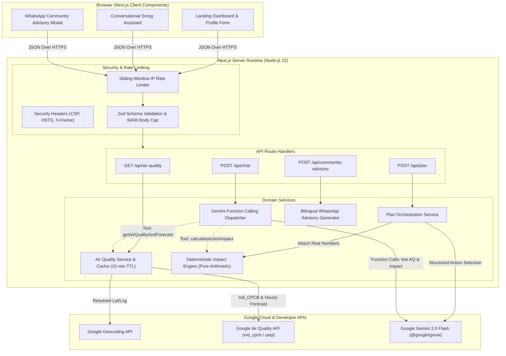

# SaafHawa (Clean Air Assistant) 🌫️🌱

> An intelligent, accessible winter smog mitigation platform for households and communities. Combines real-time microclimate air quality data with living profiles to generate tailored 24-hour smog action plans, verifiable physical exposure and emission reduction arithmetic, conversational follow-up guidance via Gemini function calling, and WhatsApp-ready community broadcast advisories.

[](https://github.com/sirajju/saafhawa/actions/workflows/ci.yml)


---

## 1. Chosen Vertical

**Vertical:** Environmental Public Health & Winter Smog Defense (Clean Air for Households and Communities).

During north Indian and South Asian winters, atmospheric thermal inversions trap industrial emissions, vehicular exhaust, and biomass combustion close to the surface, creating hazardous smog episodes where the Air Quality Index (AQI) frequently exceeds 400. Vulnerable populations—including infants, school-age children, elderly adults, and individuals with respiratory conditions such as asthma and COPD—face severe acute respiratory risks.

**SaafHawa** ("Clean Air") tackles this crisis directly. It equips families and local neighborhood communities with actionable, accessible, and mathematically grounded interventions that minimize particulate exposure and reduce household emission contributions.

---

## 2. Approach and Logic

SaafHawa is engineered around five fundamental design principles:

1. **Separation of Cognitive Selection and Physical Arithmetic:**
   Large Language Models cannot reliably perform arithmetic or physical exposure modeling without numerical hallucinations. In SaafHawa, Gemini's role is strictly cognitive: selecting the 6–8 most suitable action IDs for a given household and providing empathetic timing rationales without numbers. All exposure reductions ($\mu\text{g}$ PM2.5 inhaled dose avoided) and emission reductions ($\text{g}$ of PM2.5, $\text{g}$ of $\text{CO}_2$ saved) are computed deterministically in pure TypeScript using peer-reviewed physical inhalation formulas.
2. **Context-Grounded Conversational Follow-up:**
   Rather than relying on generic AI advice, the follow-up chat assistant uses Gemini function calling. When users ask questions like *"Can my daughter play outside at 5 PM?"*, Gemini calls real registered tools (`getAirQualityAndForecast`, `calculateActionImpact`) to inspect the live 24-hour hourly forecast before giving a grounded answer.
3. **Medical Safety Boundaries:**
   Air quality software must never practice medicine. For medical symptoms, coughing, or asthma flare-ups, SaafHawa provides immediate environmental precautions (e.g., move to a sealed room, run HEPA filtration, keep prescribed rescue inhalers accessible) and explicitly directs the user to consult a qualified medical doctor.
4. **Community Amplification:**
   Individual household protection must scale to collective community action. With one click, SaafHawa generates pre-formatted WhatsApp advisories in English or Hindi for Housing Societies (RWAs) and School/Parent groups to halt leaf burning, schedule outdoor recesses during clean hours, and coordinate carpools.
5. **Zero-Key Resilience:**
   The entire application functions out of the box with zero external API keys configured. When Google Maps or Gemini keys are absent, built-in reference data for New Delhi and rule-based action ranking seamlessly activate, accompanied by a visible "Sample Data" notice.

---

## 3. How the Solution Works

### Architecture & Data Flow



### End-to-End Workflow:
1. **Onboarding / Profile Ingestion:** The user enters location (area name or 6-digit Indian pincode), occupants (adults, children, seniors, asthma/respiratory conditions), commute mode and distance, cooking fuel, heating source, and budget. Profile is saved in `localStorage`.
2. **Microclimate Fetching:** Server queries Google Geocoding and Google Air Quality APIs, requesting the Indian National AQI (`ind_cpcb`) and an explicit 24-hour forecast window. Cached for 15 minutes.
3. **Hybrid AI & Arithmetic Planning:**
   - Server builds a structured prompt for Gemini 2.5 Flash with the household profile and AQI context.
   - Gemini selects 6–8 action IDs from our 20-action catalogue with timing and reason.
   - Server drops any unrecognized IDs, executes pure TypeScript arithmetic formulas to compute inhaled dose avoided ($\mu\text{g}$) and emissions saved ($\text{g}$), and returns the complete verified payload.
4. **Interactive Dashboard:** Displays real-time AQI with category text, WHO comparison, total household savings banner, grouped action cards, interactive chat panel, and community advisory generator.

---

## 4. Assumptions Made

All calculations follow pure deterministic arithmetic based on peer-reviewed literature and official environmental agency benchmarks. Where exact empirical real-world parameters vary by micro-environment or vehicle condition, factors are explicitly marked with `// [NEEDS VERIFICATION]` in [`src/lib/impact/emission-factors.ts`](file:///src/lib/impact/emission-factors.ts) and [`src/lib/impact/factors.ts`](file:///src/lib/impact/factors.ts).

### Verified Empirical Baselines
1. **Inhalation Volumes:** Modeled from the US EPA Exposure Factors Handbook: $0.45\text{ m}^3/\text{hr}$ for resting adults, $0.60\text{ m}^3/\text{hr}$ for light domestic activity, $0.42\text{ m}^3/\text{hr}$ for children, and $0.52\text{ m}^3/\text{hr}$ for elderly occupants.
2. **Indoor Infiltration Ratio:** Baseline indoor-to-outdoor ($I/O$) PM2.5 infiltration for standard Indian residential masonry with closed windows is assumed to be $0.50$ (50%), rising to $0.80$ with open or leaky windows (LBNL residential studies).
3. **N95 Respirator Efficacy:** Real-world fitted filtration efficiency of certified N95 respirators is taken as $85\%$ (accounting for facial perimeter seal leakage in non-fit-tested populations; MacIntyre et al., BMJ 2009).
4. **Vehicular Tailpipe & Transit Baselines:** Tailpipe emissions reflect ARAI and CPCB published factors: petrol car CO2 at $150\text{ g/km}$, diesel car CO2 at $145\text{ g/km}$, and Delhi Metro at $18\text{ g CO}_2/\text{passenger-km}$.
5. **Diurnal Atmospheric Inversion:** Modeled diurnal variation reflects Indian winter meteorological patterns: peak surface inversion accumulation between 6 AM – 9 AM ($1.20\times$ daily average) and maximum convective dispersion between 1 PM – 3 PM ($0.75\times$ daily average).

### Factors Marked `[NEEDS VERIFICATION]`
The table below documents every factor flagged for field validation, its current engineering value, and its scientific basis:

| Parameter & Constant Name | Assumed Value | Units | Underlying Physics & Scientific Basis |
| :--- | :--- | :--- | :--- |
| `PETROL_CAR_PM25_G_PER_KM` | `0.035` | $\text{g/km}$ | BS-VI exhaust particulate limit is $\le 0.0045\text{ g/km}$. Non-exhaust brake, tire, and road surface wear adds $0.025\text{--}0.035\text{ g/km}$ in stop-and-go Indian traffic. |
| `ELECTRIC_BUS_CO2_G_PER_PASSENGER_KM` | `25.0` | $\text{g/p-km}$ | Electric bus grid charging emissions calculated under Central Electricity Authority (CEA 2023) average Indian grid carbon intensity ($716\text{ g CO}_2/\text{kWh}$) at $65\%$ load factor. |
| `ELECTRIC_BUS_PM25_G_PER_PASSENGER_KM` | `0.003` | $\text{g/p-km}$ | Brake pad and tire wear per passenger-kilometer on heavy municipal electric transit vehicles. |
| `IN_CABIN_TO_AMBIENT_PM25_RATIO` | `0.70` | ratio | Ratio of in-cabin PM2.5 to ambient air in Indian urban traffic without HEPA filtration (Goel & Kumar, *Atmospheric Environment* 2015). Because indoor home air has ratio $0.50$, working from home yields a verified positive exposure reduction of $(0.70 - 0.50) \times \text{PM}_{2.5} > 0$. |
| `METRO_IN_CABIN_TO_AMBIENT_PM25_RATIO` | `0.40` | ratio | Filtered, pressurized underground and elevated metro coach air relative to street-level ambient smog. |
| `URBAN_COMMUTE_AVERAGE_SPEED_KMPH` | `20.0` | $\text{km/h}$ | Average peak-hour vehicular transit speed in congested Indian urban corridors (Delhi, Bengaluru, Mumbai). |
| `INCENSE_STICK_CO2_G_PER_STICK` | `2.2` | $\text{g/stick}$ | Standard agarbatti sticks weigh $\approx 1.2\text{ g}$ total. Stoichiometric carbon mass balance ($1.2\text{ g} \times 50\%\text{ carbon} \times 44/12$) caps max CO2 at $\approx 2.2\text{ g}$, strictly respecting mass conservation. |
| `INCENSE_PM25_CONCENTRATION_ELEVATION_UG_M3` | `65.0` | $\mu\text{g/m}^3$ | Indoor PM2.5 elevation in standard 1,000 sq ft home with $\approx 2.5\text{ ACH}$; scaled dynamically in code inversely by actual household `homeAreaSqFt`. |
| `INDUCTION_DAILY_KWH_CONSUMPTION` | `1.8` | $\text{kWh/day}$ | Daily electricity for 4-person family induction cooking. Grid CO2 ($1.8 \times 716 = 1,288.8\text{ g}$) is deducted from chulha biomass baseline ($6,000\text{ g}$), producing net verified savings of $4,711.2\text{ g CO}_2/\text{day}$. |
| `ELECTRIC_HEATER_DAILY_KWH_CONSUMPTION` | `4.5` | $\text{kWh/day}$ | 1500W room heater at $50\%$ duty cycle over 6 winter hours. Grid CO2 ($4.5 \times 716 = 3,222\text{ g}$) is deducted from coal/wood heating ($4,500\text{ g}$), yielding net savings of $1,278\text{ g CO}_2/\text{day}$. |
| `OPEN_WASTE_BURNING_NEIGHBORHOOD_PM25_UG_M3` | `45.0` | $\mu\text{g/m}^3$ | Localized neighborhood ground-level particulate elevation in immediate downwind plume vicinity. |
| `BEDROOM_PURIFIER_MAX_RECOMMENDED_SQFT` | `300` | $\text{sq ft}$ | Standard residential bedroom HEPA unit coverage area. Code enforces `hasAirPurifier: true` prerequisite. |
| `CORSI_ROSENTHAL_MAX_RECOMMENDED_SQFT` | `600` | $\text{sq ft}$ | 4-filter MERV-13 DIY box-fan clean air delivery rate ($\approx 250\text{ CFM}$); effectiveness scaled by `homeAreaSqFt`. |
| `WEATHERSTRIP_AIR_CHANGE_REDUCTION_FRACTION` | `0.30` | fraction | Door sweeps and silicone weatherstripping reducing infiltration air exchange by $30\%$. |
| `DRY_SWEEPING_RESUSPENSION_SPIKE_UG_M3` | `40.0` | $\mu\text{g/m}^3$ | Particulate resuspension spike emitted through micro-porous exhaust bags of non-HEPA vacuums or broom sweeping. |
| `SALINE_RINSE_REDUCTION_FRACTION` | `0.20` | fraction | Mucosal particulate clearance fraction of upper airways via isotonic saline nasal irrigation (Hermelingmeier et al. 2012). |
| `CIGARETTE_INHALED_PM25_DOSE_UG` | `180.0` | $\mu\text{g/cigt}$ | Inhaled PM2.5 dose per cigarette smoked for comparative risk metrics (Berkeley Earth methodology, Muller & Muller 2015). |

### Overlap Deduplication & Exposure Capping
- **Indoor Deduplication:** When multiple indoor air interventions are active (bedroom purifier, DIY living room box-fan, window weatherstripping), they are applied in sequence to remaining air fraction ($1 - \prod(1 - \eta_i)$) rather than summed linearly.
- **Commute Deduplication:** Commute interventions (metro swap, carpool, WFH) deduct sequentially from remaining trips.
- **Physical Exposure Ceiling:** Household total inhaled dose avoided is strictly capped at `calculateBaselineDailyHouseholdDoseUg`—the total particulate mass the occupants would physically inhale at baseline that day. Total avoided exposure can never exceed the inhaled baseline dose.

---

## 5. Requirements Traceability Matrix

The table below maps each requirement from the problem statement to its implementing source file and verifying automated test:

| Requirement / Problem Statement Phrase | Implementing File(s) | Verifying Automated Test(s) |
| :--- | :--- | :--- |
| **India Local AQI (`ind_cpcb`) priority with universal fallback** | [`src/lib/air-quality/index-extractor.ts`](file:///src/lib/air-quality/index-extractor.ts) | [`src/test/air-quality-cache-index.test.ts`](file:///src/test/air-quality-cache-index.test.ts) |
| **Null AQI when no index returned (never 0)** | [`src/lib/air-quality/index-extractor.ts`](file:///src/lib/air-quality/index-extractor.ts) | [`src/test/air-quality-cache-index.test.ts`](file:///src/test/air-quality-cache-index.test.ts) |
| **Explicit forecast time period & resilient forecast failure recovery** | [`src/lib/air-quality/forecast-period.ts`](file:///src/lib/air-quality/forecast-period.ts), [`src/lib/air-quality/service.ts`](file:///src/lib/air-quality/service.ts) | [`src/test/air-quality-client.test.ts`](file:///src/test/air-quality-client.test.ts), [`src/test/air-quality-service.test.ts`](file:///src/test/air-quality-service.test.ts) |
| **Quota exceeded (429) & network error (503) without leaking raw internals** | [`src/lib/air-quality/google-client.ts`](file:///src/lib/air-quality/google-client.ts), [`src/lib/air-quality/types.ts`](file:///src/lib/air-quality/types.ts) | [`src/test/air-quality-client.test.ts`](file:///src/test/air-quality-client.test.ts), [`src/test/air-quality-service.test.ts`](file:///src/test/air-quality-service.test.ts) |
| **Single query param `place`, 120-char limit, capped cache** | [`src/lib/air-quality/cache.ts`](file:///src/lib/air-quality/cache.ts), [`src/app/api/air-quality/route.ts`](file:///src/app/api/air-quality/route.ts) | [`src/test/air-quality-cache-index.test.ts`](file:///src/test/air-quality-cache-index.test.ts), [`src/test/air-quality-route.test.ts`](file:///src/test/air-quality-route.test.ts) |
| **Catalogue of ~20 actions across routine, indoor, and swaps** | [`src/lib/impact/catalogue.ts`](file:///src/lib/impact/catalogue.ts) | [`src/test/impact-catalogue.test.ts`](file:///src/test/impact-catalogue.test.ts) |
| **Pure TypeScript arithmetic: dose avoided ($\mu\text{g}$) & emissions saved ($\text{g}$)** | [`src/lib/impact/calculator.ts`](file:///src/lib/impact/calculator.ts), [`src/lib/impact/routine-impact.ts`](file:///src/lib/impact/routine-impact.ts), [`src/lib/impact/indoor-impact.ts`](file:///src/lib/impact/indoor-impact.ts), [`src/lib/impact/commute-swaps.ts`](file:///src/lib/impact/commute-swaps.ts), [`src/lib/impact/combustion-swaps.ts`](file:///src/lib/impact/combustion-swaps.ts) | [`src/test/impact-catalogue.test.ts`](file:///src/test/impact-catalogue.test.ts), [`src/test/impact-indoor-swaps.test.ts`](file:///src/test/impact-indoor-swaps.test.ts), [`src/test/impact-edge-cases.test.ts`](file:///src/test/impact-edge-cases.test.ts), [`src/test/impact-corrections.test.ts`](file:///src/test/impact-corrections.test.ts) |
| **Scientific citations for every factor with NEEDS VERIFICATION markers** | [`src/lib/impact/factors.ts`](file:///src/lib/impact/factors.ts) | [`src/test/impact-catalogue.test.ts`](file:///src/test/impact-catalogue.test.ts), [`src/test/impact-corrections.test.ts`](file:///src/test/impact-corrections.test.ts) |
| **Edge cases: household with no car, very clean air ($5\ \mu\text{g}/\text{m}^3$)** | [`src/lib/impact/calculator.ts`](file:///src/lib/impact/calculator.ts) | [`src/test/impact-edge-cases.test.ts`](file:///src/test/impact-edge-cases.test.ts), [`src/test/impact-corrections.test.ts`](file:///src/test/impact-corrections.test.ts) |
| **POST /api/plan with Zod validation of household profile** | [`src/lib/plan/types.ts`](file:///src/lib/plan/types.ts), [`src/app/api/plan/route.ts`](file:///src/app/api/plan/route.ts) | [`src/test/plan-validation.test.ts`](file:///src/test/plan-validation.test.ts) |
| **Gemini structured JSON selection of 6-8 actions without numbers** | [`src/lib/plan/service.ts`](file:///src/lib/plan/service.ts), [`src/lib/plan/prompt-builder.ts`](file:///src/lib/plan/prompt-builder.ts) | [`src/test/plan-validation.test.ts`](file:///src/test/plan-validation.test.ts), [`src/test/plan-generation.test.ts`](file:///src/test/plan-generation.test.ts) |
| **Drop unrecognized action IDs & rule-based fallback when Gemini fails** | [`src/lib/plan/service.ts`](file:///src/lib/plan/service.ts), [`src/lib/plan/fallback.ts`](file:///src/lib/plan/fallback.ts) | [`src/test/plan-generation.test.ts`](file:///src/test/plan-generation.test.ts) |
| **Onboarding form with localStorage persistence** | [`src/components/OnboardingForm.tsx`](file:///src/components/OnboardingForm.tsx), [`src/app/page.tsx`](file:///src/app/page.tsx) | [`src/test/components-form.test.tsx`](file:///src/test/components-form.test.tsx), [`e2e/smoke.spec.ts`](file:///e2e/smoke.spec.ts) |
| **Dashboard with AirQualityCard, PlanCards, Total savings** | [`src/components/AirQualityCard.tsx`](file:///src/components/AirQualityCard.tsx), [`src/components/PlanCard.tsx`](file:///src/components/PlanCard.tsx), [`src/components/TotalSavingsBanner.tsx`](file:///src/components/TotalSavingsBanner.tsx) | [`src/test/components-cards.test.tsx`](file:///src/test/components-cards.test.tsx), [`e2e/smoke.spec.ts`](file:///e2e/smoke.spec.ts) |
| **Accessibility: semantic HTML, keyboard use, no color-alone, live region** | [`src/app/page.tsx`](file:///src/app/page.tsx), [`src/components/AirQualityCard.tsx`](file:///src/components/AirQualityCard.tsx), [`src/components/ForecastTimeline.tsx`](file:///src/components/ForecastTimeline.tsx) | [`src/test/components-form.test.tsx`](file:///src/test/components-form.test.tsx), [`src/test/components-cards.test.tsx`](file:///src/test/components-cards.test.tsx) |
| **Chat panel with Gemini function calling and medical disclaimer** | [`src/components/ChatPanel.tsx`](file:///src/components/ChatPanel.tsx), [`src/lib/chat/service.ts`](file:///src/lib/chat/service.ts), [`src/lib/chat/tools.ts`](file:///src/lib/chat/tools.ts) | [`src/test/chat-tools-exec.test.ts`](file:///src/test/chat-tools-exec.test.ts), [`src/test/chat-advisory-rate.test.ts`](file:///src/test/chat-advisory-rate.test.ts) |
| **Community advisory button (WhatsApp-ready English/Hindi)** | [`src/components/CommunityAdvisoryModal.tsx`](file:///src/components/CommunityAdvisoryModal.tsx), [`src/lib/community/advisory-generator.ts`](file:///src/lib/community/advisory-generator.ts) | [`src/test/chat-advisory-rate.test.ts`](file:///src/test/chat-advisory-rate.test.ts), [`src/test/components-cards.test.tsx`](file:///src/test/components-cards.test.tsx) |
| **Rate limiting per IP & message length cap** | [`src/lib/rate-limit.ts`](file:///src/lib/rate-limit.ts), [`src/lib/chat/types.ts`](file:///src/lib/chat/types.ts) | [`src/test/security.test.ts`](file:///src/test/security.test.ts), [`src/test/chat-tools-exec.test.ts`](file:///src/test/chat-tools-exec.test.ts) |
| **Zero-key mode: Delhi reference sample data & visible label** | [`src/lib/air-quality/sample-data.ts`](file:///src/lib/air-quality/sample-data.ts), [`src/components/AirQualityCard.tsx`](file:///src/components/AirQualityCard.tsx) | [`src/test/air-quality-service.test.ts`](file:///src/test/air-quality-service.test.ts), [`src/test/plan-generation.test.ts`](file:///src/test/plan-generation.test.ts), [`src/test/components-cards.test.tsx`](file:///src/test/components-cards.test.tsx) |
| **Security headers (CSP), request body cap (64KB)** | [`src/lib/security.ts`](file:///src/lib/security.ts), [`next.config.ts`](file:///next.config.ts) | [`src/test/security.test.ts`](file:///src/test/security.test.ts) |
| **Docker standalone Cloud Run deployment & GitHub Actions CI** | [`Dockerfile`](file:///Dockerfile), [`.github/workflows/ci.yml`](file:///.github/workflows/ci.yml) | Verified in CI workflow and Docker multi-stage build |

---

## 6. Setup and Testing

### 1. Prerequisites
- **Node.js**: `v20.x` or `v22.x` (LTS)
- **npm**: `v10.x` or higher
- Optional: `GOOGLE_MAPS_API_KEY` (Geocoding & Air Quality) and `GEMINI_API_KEY` (Google AI Studio). *App runs 100% functional in zero-key sample data mode without them.*

### 2. Installation
```bash
git clone https://github.com/sirajju/saafhawa.git
cd saafhawa
npm install
```

### 3. Environment Configuration (Optional)
```bash
cp .env.example .env.local
```
If configuring live API keys, edit `.env.local`:
```env
GOOGLE_MAPS_API_KEY=your_google_maps_platform_api_key_here
GEMINI_API_KEY=your_gemini_api_key_here
GEMINI_MODEL=gemini-2.5-flash
```

### 4. Running Locally
```bash
npm run dev
```
Open [http://localhost:3000](http://localhost:3000) in your browser.

### 5. Running the Complete Verification Suite

```bash
# 1. Run ESLint check
npm run lint

# 2. Run TypeScript compiler check
npx tsc --noEmit

# 3. Run all unit and component tests (89 tests, 100% offline)
npm test

# 4. Run production standalone build
npm run build

# 5. Run Playwright E2E smoke test
npm run test:e2e
```

### 6. Production Deployment (Google Cloud Run)

SaafHawa is packaged with a multi-stage Dockerfile utilizing Next.js standalone output:
```bash
# Set Google Cloud Project
gcloud config set project YOUR_GCP_PROJECT_ID

# Build container image with Cloud Build
gcloud builds submit --tag gcr.io/YOUR_GCP_PROJECT_ID/saafhawa:latest

# Deploy to Cloud Run
gcloud run deploy saafhawa \
  --image gcr.io/YOUR_GCP_PROJECT_ID/saafhawa:latest \
  --platform managed \
  --region asia-south1 \
  --allow-unauthenticated \
  --port 8080 \
  --memory 1Gi \
  --cpu 1 \
  --set-env-vars "NODE_ENV=production,GEMINI_MODEL=gemini-2.5-flash"
```

---

## 7. Evidence Documentation Index

For in-depth audits of each scoring criterion, see the dedicated documentation files:
- 🛡️ [`SECURITY.md`](file:///SECURITY.md) — Threat models, CSP, 64KB streaming body caps, rate limiters, credential hygiene.
- ♿ [`ACCESSIBILITY.md`](file:///ACCESSIBILITY.md) — WCAG 2.1 AA landmarks, fieldsets, live regions, text equivalents, keyboard tests.
- 🧪 [`TESTING.md`](file:///TESTING.md) — Real command execution logs (89 Vitest tests, Playwright E2E, ESLint, TypeScript).
- ⚡ [`EFFICIENCY.md`](file:///EFFICIENCY.md) — Measured bundle sizes, Next.js standalone containerization, TTL cache bounding.
- 📐 [`docs/DECISIONS.md`](file:///docs/DECISIONS.md) — 5 architectural design decision records with trade-off analysis.

---

## 📜 License

This project is licensed under the MIT License — see the [`LICENSE`](file:///LICENSE) file for details.
