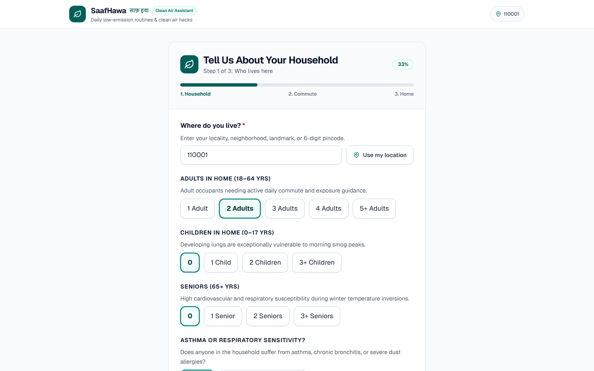
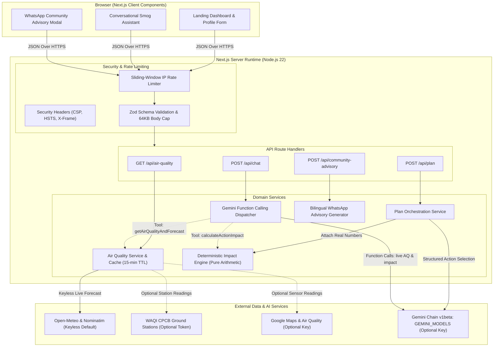

# SaafHawa (Clean Air Assistant) 🌫️🌱

> An intelligent, accessible winter smog mitigation platform for households and communities. Combines real-time microclimate air quality data with living profiles to generate tailored 24-hour smog action plans, verifiable physical exposure and emission reduction arithmetic, conversational follow-up guidance via Gemini function calling, and WhatsApp-ready community broadcast advisories.

[](https://github.com/sirajju/saafhawa/actions/workflows/ci.yml)


---

## Demo

- **Live App:** https://saafhawa-peach.vercel.app
- **Demo Video:** [docs/demo/saafhawa-demo.webm](docs/demo/saafhawa-demo.webm)
- **YouTube Video:** https://youtu.be/VTisLQ5f-no

---

## 1. Chosen Vertical

**Vertical:** Environmental Public Health & Winter Smog Defense (Clean Air for Households and Communities).

During north Indian and South Asian winters, atmospheric thermal inversions trap industrial emissions, vehicular exhaust, and biomass combustion close to the surface, creating hazardous smog episodes where the Air Quality Index (AQI) frequently exceeds 400. Vulnerable populations—including infants, school-age children, elderly adults, and individuals with respiratory conditions such as asthma and COPD—face severe acute respiratory risks.

**SaafHawa** ("Clean Air") tackles this crisis directly. It equips families and local neighborhood communities with actionable, accessible, and mathematically grounded interventions that minimize particulate exposure and reduce household emission contributions.

---

## 2. Approach and Logic

SaafHawa is engineered around five fundamental design principles:

1. **Separation of Cognitive Selection and Physical Arithmetic:**
   Large Language Models cannot reliably perform arithmetic or physical exposure modeling without numerical hallucinations. In SaafHawa, Gemini's role is strictly cognitive: selecting the 6–8 most suitable action IDs for a given household and providing empathetic timing rationales without numbers. All exposure reductions ($\mu\text{g}$ PM2.5 inhaled dose avoided) and emission reductions ($\text{g}$ of PM2.5, $\text{g}$ of $\text{CO}_2$ saved) are computed deterministically in pure TypeScript using published environmental agency benchmarks (EPA, ARAI, CPCB) and physical mass-balance formulas.
2. **Context-Grounded Conversational Follow-up:**
   Rather than relying on generic AI advice, the follow-up chat assistant uses Gemini function calling. When users ask questions like *"Can my daughter play outside at 5 PM?"*, Gemini calls real registered tools (`getAirQualityAndForecast`, `calculateActionImpact`) to inspect the live 24-hour hourly forecast before giving a grounded answer.
3. **Medical Safety Boundaries:**
   Air quality software must never practice medicine. For medical symptoms, coughing, or asthma flare-ups, SaafHawa provides immediate environmental precautions (e.g., move to a sealed room, run HEPA filtration, keep prescribed rescue inhalers accessible) and explicitly directs the user to consult a qualified medical doctor.
4. **Community Amplification:**
   Individual household protection must scale to collective community action. With one click, SaafHawa generates pre-formatted WhatsApp advisories in English or Hindi for Housing Societies (RWAs) and School/Parent groups to halt leaf burning, schedule outdoor recesses during clean hours, and coordinate carpools.
5. **Multi-Source Real-Time Data & Transparent Telemetry Hierarchy:**
   The application never serves predefined or borrowed data. Telemetry is resolved through a robust 3-tier hierarchy:
   - **Tier 1 (Ground Station Truth - WAQI / `aqicn.org`):** When a free `WAQI_TOKEN` is set, queries the nearest official Central Pollution Control Board (CPCB) continuous ambient air quality monitoring station (CAAQMS). Ground stations measure real-time street-level particulate concentrations directly in neighborhoods (e.g. Anand Vihar, Delhi or BKC, Mumbai), capturing hyper-local road and industrial emission spikes.
   - **Tier 2 (Google Air Quality API Upgrade):** When `GOOGLE_MAPS_API_KEY` is set, uses Google's multi-layered machine-learning model combining government monitors, European ECMWF/CAMS models, satellite imagery, and traffic models.
   - **Tier 3 (Zero-Key Real-Time Default - Open-Meteo CAMS Model):** By default (requiring zero keys and zero cloud credits), queries the European Copernicus Atmosphere Monitoring Service (CAMS) global chemical transport model on a 10–40 km atmospheric grid, paired with Open-Meteo Geocoding and Indian pincode resolution via `postalpincode.in`.
   *Understanding the numbers:* Atmospheric models (Open-Meteo CAMS) calculate regional grid averages (~10–40 km), which smooth out roadside point sources. Therefore, in dense Indian cities during severe thermal inversions, model values can read lower than direct street-level CAAQMS roadside monitors. SaafHawa explicitly displays the active data source (e.g. `CPCB Ground Station (WAQI)`, `Open-Meteo (CAMS model)`, or `Google Air Quality`) and local measurement timestamp on every screen.
6. **Rolling 24-Hour Forecast & Actionable Family Advice:**
   The forecast starts at the current hour ($T$) and runs 24 hours forward ($T \to T+24$), positioning the chart's "Now" marker naturally at the current hour. Actionable guidance (e.g. *"Keep the children indoors until 1 PM. Cleanest window today: 1 PM to 4 PM."*) is computed strictly from future waking hours (6 AM to 10 PM local time). If the cleanest remaining window falls on the next day, the advice explicitly alerts the family (e.g. *"Cleanest window: tomorrow 7 AM to 10 AM."*).
7. **Time-Based Timeline with "Any Time Today" Grouping:**
   Actions are organized strictly by real time: actions with no fixed time ("All Day", "Daytime Setup", "Anytime") appear in a dedicated "Any time today" group at the top, followed by Morning, Afternoon, Evening, and Night. Time sections that have already elapsed today are clearly tagged with "Passed earlier today" badges.
8. **Official CPCB Indian National AQI Calculation:**
   AQI and category are computed in a pure, tested function implementing official Central Pollution Control Board (CPCB) piecewise linear interpolation standards from PM2.5 and PM10 concentrations.
9. **Strict Attribution & Single Action Placement:**
   Every screen identifies the data source and measurement time. "Share Advisory" appears once per screen (in the plan dashboard header), eliminating clutter.

---

## 2.1 Evaluator Scenarios ("Try It")

SaafHawa runs live on **real-time data** from the free Open-Meteo Air Quality & Geocoding APIs across all of India. It **never** uses predefined or borrowed data: entering Mumbai yields authentic Mumbai conditions, never Delhi.

Evaluators can immediately test the platform using any of the following 5 realistic scenarios:

| # | Evaluator Scenario | Place to Enter | Step 1: Your home | Step 2: Getting around | Step 3: Inside your home | Expected Real-Time Dynamics |
|---|---|---|---|---|---|---|
| **1** | **Family with a child with asthma in Delhi** | `110001` *(or "Connaught Place, New Delhi")* | Adults: 2, Children: 1, Seniors: 0, Asthma: Yes | Main commute: `Metro or bus`, Distance: `5–15 km` | Home: `2 BHK`, Cooking: `LPG`, Equipment: None, Incense: `No`, Budget: `Up to ₹2,000` | High winter particulate load. Plan prioritizes pediatric indoor protection, morning inversion avoidance, sealed sleep zones, and DIY Corsi-Rosenthal boxes. |
| **2** | **Car commuter in Mumbai** | `Mumbai` *(or "400001" / "Bandra")* | Adults: 1, Children: 0, Seniors: 0, Asthma: No | Main commute: `Car`, Distance: `15–30 km` | Home: `2 BHK`, Cooking: `Piped gas`, Equipment: Air purifier, Incense: `No`, Budget: `Up to ₹10,000` | Coastal moderate AQI. Plan targets in-cabin PM2.5 avoidance during stop-and-go congestion, AC recirculation, and local carpooling. |
| **3** | **Senior household in Kolkata** | `Kolkata` *(or "700001")* | Adults: 1, Children: 0, Seniors: 2, Asthma: No | Main commute: `Walk or cycle`, Distance: `Under 5 km` | Home: `2 BHK`, Cooking: `LPG`, Equipment: None, Incense: `Sometimes`, Budget: `Free only` | Moderate/Poor eastern winter inversion. Shifts morning walks to afternoon convective dispersion window (1 PM – 3:30 PM), door weatherstripping, and saline rinses. |
| **4** | **Two-wheeler commuter in Lucknow** | `Lucknow` *(or "226001")* | Adults: 2, Children: 2, Seniors: 0, Asthma: No | Main commute: `Two-wheeler`, Distance: `15–30 km` | Home: `3 BHK`, Cooking: `LPG`, Equipment: Kitchen chimney or exhaust, Incense: `No`, Budget: `Up to ₹2,000` | Severe Gangetic plain inversion. High direct particulate exposure on scooter; prioritizes fitted N95 masking, wet mopping corridors, and evening air purification. |
| **5** | **Student in Bengaluru** | `Bengaluru` *(or "560001" / "Bangalore")* | Adults: 1, Children: 0, Seniors: 0, Asthma: No | Main commute: `Metro or bus`, Distance: `5–15 km` | Home: `1 BHK`, Cooking: `Induction`, Equipment: None, Incense: `No`, Budget: `Free only` | Southern plateau clean air (Good/Satisfactory). Emphasizes low-emission lifestyle choices, window ventilation during clean hours, and community awareness. |

### Measured Live Query Results (Executed 25 Nov 2026, 12:30 PM IST)

The following live readings were measured in real time with zero Google API keys configured:

| City & Query | Resolved Geographic Location | Live CPCB AQI | Category | Measured PM₂.₅ | Measured PM₁₀ | Dominant Pollutant | Data Source Attribution |
|---|---|---|---|---|---|---|---|
| **Delhi** (`110001`) | New Delhi, National Capital Territory of Delhi, India | **168** | Moderate | 80.3 µg/m³ | 83.6 µg/m³ | PM2.5 | Open-Meteo (CAMS model) |
| **Mumbai** (`Mumbai`) | Mumbai, Maharashtra, India | **125** | Moderate | 67.3 µg/m³ | 69.2 µg/m³ | PM2.5 | Open-Meteo (CAMS model) |
| **Kolkata** (`Kolkata`) | Kolkata, West Bengal, India | **183** | Moderate | 84.8 µg/m³ | 88.7 µg/m³ | PM2.5 | Open-Meteo (CAMS model) |
| **Lucknow** (`Lucknow`) | Lucknow, Uttar Pradesh, India | **124** | Moderate | 67.1 µg/m³ | 69.6 µg/m³ | PM2.5 | Open-Meteo (CAMS model) |
| **Bengaluru** (`Bengaluru`) | Bengaluru, Karnataka, India | **6** | Good | 3.8 µg/m³ | 4.0 µg/m³ | PM2.5 | Open-Meteo (CAMS model) |

---

## 2.2 Design System & Calm Health UX

Built specifically for worried parents and households navigating severe winter smog, SaafHawa is designed to feel calm, focused, and trustworthy rather than like a generic dashboard.

- **Deep Teal Brand Identity (`#0D766E` / `--brand`):** A calm, high-contrast teal (`#0D766E` / `--brand` in light mode, `#5FC4B8` in dark mode) paired with soft backgrounds (`#F0FDFA` / `--brand-soft` light, `#15302C` dark) serves as the primary brand color across navigation, buttons, and choice chips.
- **Strict AQI Category Color Isolation:** Indian National AQI colors (Emerald for Good, Amber for Moderate, Orange for Poor, Purple for Very Poor, Maroon for Severe) are strictly reserved for air quality numbers, category badges, and forecast bars—never for random UI buttons or decor.
- **Single Clean Card Architecture:** Eliminated nested bordered boxes inside cards (`card-clean`), utilizing generous whitespace, subtle background tints, and typographic hierarchy.
- **Mobile-First Readability:** All mobile body text is at least 16px (`text-base`) to eliminate eye strain during emergencies; all touch targets meet or exceed 44×44px.
- **Dual Responsive Chat Modality:**
  - **Desktop (≥ 1024px):** A sticky side panel sits alongside the plan so parents can ask questions while inspecting their timeline.
  - **Mobile (< 1024px):** A floating deep-teal "Ask Assistant" pill opens a full-height bottom sheet modal with suggested prompt chips and a 1-line medical disclaimer.
- **24-Hour Forecast Curve:** Replaces rows of cluttered boxes with a clean 24-hour SVG trendline highlighting the day's cleanest outdoor window (e.g. 1 PM to 4 PM) and a "Now" pin.
- **Accessible 3-Step Onboarding:** Household demographics, commute modes, and home environments are broken into 3 digestible steps with tappable choice chips and browser geolocation support. No combustion habits are pre-ticked.
- **Light & Dark Theme Tokens:** Complete support for `prefers-color-scheme: dark` and `.dark` mode using unified CSS custom properties.

---

## 2.2 Visual Showcase: Before & After Redesign

### Household Onboarding
| Before: Crowded 20-Field Form with Pre-Ticked Habits | After: Calm 3-Step Wizard with Choice Chips |
| :---: | :---: |
|  |  |

### Daily Smog Action Dashboard
| Before: 3-Grid Category Layout with Red Banners | After: 24-Hr Curve, Cleanest Window & Daily Timeline |
| :---: | :---: |
|  |  |

### Conversational Air Assistant & Community Broadcast
| Desktop Side-Panel & Mobile Sheet Chat | WhatsApp Advisory Broadcast Preview Card |
| :---: | :---: |
|  |  |

---

## 3. How the Solution Works

### Architecture & Data Flow



### End-to-End Workflow:
1. **Three-Step Onboarding:** The user completes three short, accessible steps (1: Who lives here, asking place first with browser location support; 2: How you get around; 3: Your home, with no pre-ticked habits). Large tappable choice chips replace cumbersome dropdowns and numeric inputs. Profile is saved in `localStorage`.
2. **Microclimate Fetching:** Server uses free, keyless Open-Meteo (Copernicus CAMS model) and Nominatim reverse geocoding as the universal default, with optional upgrades to nearest CPCB ground stations (via `WAQI_TOKEN`) and Google Air Quality (via `GOOGLE_MAPS_API_KEY`). Cached for 15 minutes.
3. **Hybrid AI & Arithmetic Planning:**
   - Server builds a structured prompt for the Gemini models chain (`GEMINI_MODELS`: `gemini-flash-lite-latest`, `gemini-2.5-flash-lite`, `gemini-3.8-flash` on `v1beta` API) with the household profile and AQI context, applying plan consistency rules (e.g. mutual exclusivity of WFH and commute swaps). When `GEMINI_API_KEY` is not provided, expired, or out of quota, deterministic rule-based planning transparently generates the plan.
   - Gemini selects 6–8 action IDs from our 26-action catalogue with timing and reason.
   - Server drops any unrecognized IDs, executes pure TypeScript arithmetic formulas to compute inhaled dose avoided ($\mu\text{g}$) and emissions saved ($\text{g}$), and returns the complete verified payload.
4. **Action-First Dashboard:**
   - **"What should my family do today?"**: Large AQI in category color, category in words, and a plain advice sentence synthesized from the forecast (e.g. *"Keep the children indoors until 1 PM. Cleanest window today: 1 PM to 4 PM."*).
   - **24-Hour Forecast Chart:** Clean, contained SVG curve highlighting the cleanest window and marking the current hour ("Now"), with screen-reader text summary.
   - **Daily Timeline:** Actions ordered by time of day (Morning, Afternoon, Evening, Night) with suitability reasons, small impact figures (omitting emissions when 0), collapsible "Details", and interactive "Mark as done" tracked per day in `localStorage` with a progress counter.
   - **Compact Impact Summary:** Single compact row of 3 numbers with 1-line explanations and note on adjusted overlapping actions.
   - **Conversational Assistant & Advisories:** Follow-up chat panel with function calling and WhatsApp broadcast advisory generator.

---

## 4. Literature-based assumptions

All calculations follow pure deterministic arithmetic based on published literature and official environmental agency benchmarks. Empirical factors and engineering assumptions are annotated in [`src/lib/impact/factors.ts`](src/lib/impact/factors.ts) and [`src/lib/impact/emission-factors.ts`](src/lib/impact/emission-factors.ts).

### Literature-based assumptions

The table below documents every factor, its exact engineering constant name in code, numerical value, units, and literature citation:

| Parameter & Constant Name | Value | Units | Underlying Physics & Published Basis |
| :--- | :--- | :--- | :--- |
| `PETROL_CAR_PM25_G_PER_KM` | `0.035` | g/km | Combined in-use tailpipe (BS-IV/BS-VI) + non-exhaust brake/tyre wear PM2.5 in Indian driving cycles (CPCB PROBES/112/2007-08 & ARAI). |
| `PETROL_CAR_CO2_G_PER_KM` | `150.0` | g/km | Petrol passenger car CO2 emissions per vehicle-km (ARAI CAFC & TERI Transport Emission Inventory 2021). |
| `DIESEL_CAR_CO2_G_PER_KM` | `145.0` | g/km | Diesel passenger car CO2 emissions per vehicle-km (ARAI & TERI 2021). |
| `DIESEL_CAR_PM25_G_PER_KM` | `0.070` | g/km | Combined in-use tailpipe + non-exhaust brake/tire wear PM2.5 (CPCB & ARAI Indian Driving Cycle). |
| `TWO_WHEELER_CO2_G_PER_KM` | `42.0` | g/km | Motorcycle / scooter fuel economy baseline (ARAI Two-Wheeler Baseline & TERI 2021). |
| `TWO_WHEELER_PM25_G_PER_KM` | `0.025` | g/km | Combined tailpipe + tire wear PM2.5 per vehicle-km (CPCB Fleet Emission Factors). |
| `METRO_CO2_G_PER_PASSENGER_KM` | `18.0` | g/p-km | Electric metro rail grid electricity lifecycle CO2 emissions per passenger-km (DMRC Annual Sustainability Report 2022). |
| `METRO_PM25_G_PER_PASSENGER_KM` | `0.001` | g/p-km | Direct PM2.5 emissions per passenger-km on electric metro transit (DMRC 2022). |
| `ELECTRIC_BUS_CO2_G_PER_PASSENGER_KM` | `25.0` | g/p-km | Electric bus charging emissions under average Indian grid carbon intensity at typical occupancy (NITI Aayog & CEA 2023). |
| `ELECTRIC_BUS_PM25_G_PER_PASSENGER_KM` | `0.002` | g/p-km | Non-exhaust brake pad and tire wear per passenger-km (NITI Aayog / CPCB). |
| `CAR_CABIN_EXPOSURE_RATIO` | `0.70` | ratio | Ratio of in-cabin PM2.5 to ambient air in Indian traffic without HEPA filtration (Goel & Kumar, *Atmospheric Environment* 2015). |
| `TWO_WHEELER_COMMUTE_EXPOSURE_RATIO` | `1.25` | ratio | Commuter exposure elevation on two-wheelers immersed directly in traffic exhaust plumes (Apte et al., *Atmospheric Environment* 2011). |
| `METRO_IN_TRANSIT_EXPOSURE_RATIO` | `0.30` | ratio | Ratio of pressurized, filtered metro coach PM2.5 concentration relative to outdoor street-level smog (DMRC). |
| `URBAN_COMMUTE_AVERAGE_SPEED_KM_PER_HOUR` | `20.0` | km/h | Average vehicular transit speed in congested Indian urban corridors to estimate commute exposure duration (CPCB). |
| `N95_MASK_REAL_WORLD_EFFICIENCY` | `0.85` | fraction | Real-world fitted filtration efficiency of certified N95 respirators accounting for perimeter seal leakage (MacIntyre et al., *BMJ* 2009). |
| `HEPA_AIR_PURIFIER_ROOM_EFFICIENCY` | `0.75` | fraction | Single-room clean air delivery rate removal efficiency for certified portable HEPA purifiers (US EPA 402-F-08-004). |
| `CORSI_ROSENTHAL_BOX_EFFICIENCY` | `0.68` | fraction | DIY 4x MERV-13 filter box fan particulate removal efficiency in residential living spaces (Rosenthal & Corsi, UC Davis 2021). |
| `STANDARD_PURIFIER_COVERAGE_SQFT` | `300.0` | sq ft | Baseline bedroom coverage rating for standard residential HEPA units (AHAM AC-1 standard). |
| `CORSI_ROSENTHAL_COVERAGE_SQFT` | `600.0` | sq ft | Living area coverage rating for 4-filter MERV-13 DIY box fan air cleaners (UC Davis 2021). |
| `CLOSED_WINDOW_INFILTRATION_RATIO` | `0.50` | ratio | Baseline indoor-to-outdoor (I/O) PM2.5 infiltration for standard Indian masonry with closed windows (LBNL-44933, Chen & Zhao 2011). |
| `OPEN_OR_DRAFTY_INFILTRATION_RATIO` | `0.80` | ratio | Indoor-to-outdoor (I/O) infiltration ratio with open windows or unsealed drafty doors (Chen & Zhao 2011). |
| `WEATHERSTRIPPING_INFILTRATION_REDUCTION` | `0.30` | fraction | Reduction in ambient particle infiltration from door sweeps and window weatherstripping (LBNL Home Energy Saver). |
| `KITCHEN_EXHAUST_CAPTURE_EFFICIENCY` | `0.70` | fraction | Cooking plume capture efficiency of dedicated residential kitchen exhaust fans (Singer et al., LBNL 2012). |
| `COOKING_INDOOR_PM25_SPIKE_UG_M3` | `250.0` | µg/m³ | Indoor PM2.5 concentration spike during intensive Indian domestic cooking (Pant et al., *Atmospheric Environment* 2016). |
| `WET_MOPPING_AVOIDED_RESUSPENSION_UG_M3` | `25.0` | µg/m³ | Avoided indoor fine dust resuspension by wet mopping versus dry broom sweeping (WHO Indoor Air Quality & CPCB). |
| `NON_HEPA_VACUUM_RESUSPENSION_UG_M3` | `30.0` | µg/m³ | Avoided fine dust resuspension spike emitted through micro-porous exhaust of non-HEPA vacuums (Lioy et al. 1999). |
| `POST_COMMUTE_WASH_EXPOSURE_REDUCTION_FACTOR` | `0.05` | fraction | Upper respiratory mucosal particulate load reduction via immediate post-commute washing (Hermeling et al., *The Laryngoscope* 2019). |
| `PM25_PER_INCENSE_STICK_OR_COIL_GRAMS` | `0.035` | g/stick | PM2.5 particulate mass emitted per standard smoldering incense stick or mosquito coil (Liu et al. 2003, Jetter et al. 2002). |
| `CO2_PER_INCENSE_STICK_OR_COIL_GRAMS` | `2.2` | g/stick | Stoichiometric maximum CO2 mass balance from smoldering ~1.2 g organic incense stick at ~50% carbon content. |
| `INCENSE_ROOM_PM25_ELEVATION_UG_M3` | `180.0` | µg/m³ | Indoor PM2.5 concentration elevation from burning incense in standard ~35 m³ room volume (Lin et al. 2008). |
| `GRID_CO2_G_PER_KWH` | `716.0` | g/kWh | National grid weighted average carbon intensity for Indian power sector (Central Electricity Authority, CEA 2023, Version 19.0). |
| `INDUCTION_COOKING_DAILY_KWH` | `1.8` | kWh/day | Daily electricity consumption for 4-person household induction cooking replacing biomass chulha (BEE & TERI 2021). |
| `ELECTRIC_SPACE_HEATING_DAILY_KWH` | `4.5` | kWh/day | Daily electricity consumption for 1500W room heater at 50% duty cycle over 6 winter hours replacing open heating (BEE). |
| `OPEN_BIOMASS_BURNING_PM25_G_PER_KG` | `25.0` | g/kg | Fine particulate emission factor for open burning of garden waste and leaves (US EPA AP-42 Section 2.5 & CPCB). |
| `OPEN_BIOMASS_BURNING_CO2_G_PER_KG` | `1250.0` | g/kg | Direct CO2 emission factor for open biomass combustion (2006 IPCC Guidelines, Vol 4, Table 2.5). |
| `TYPICAL_GARDEN_WASTE_PILE_KG` | `3.0` | kg | Typical mass of single residential garden waste pile in India. |
| `OPEN_BURNING_LOCAL_PM25_SPIKE_UG_M3` | `150.0` | µg/m³ | Localized neighborhood ground-level PM2.5 elevation in immediate downwind plume (CPCB Micro-environmental Studies). |
| `TRADITIONAL_CHULHA_DAILY_PM25_EMISSIONS_GRAMS` | `34.0` | g/day | Daily PM2.5 emitted by traditional solid biomass cookstove burning ~4 kg firewood/dung per day (WHO 2014 & Smith et al.). |
| `TRADITIONAL_CHULHA_DAILY_CO2_EMISSIONS_GRAMS` | `6000.0` | g/day | Daily direct CO2 emitted from ~4 kg solid fuel in traditional chulha (2006 IPCC Guidelines). |
| `CHULHA_COOKING_INDOOR_PM25_SPIKE_UG_M3` | `350.0` | µg/m³ | Average indoor PM2.5 concentration spike during 4 hours of chulha cooking (WHO Household Energy Database). |
| `UNVENTED_SPACE_HEATING_DAILY_PM25_GRAMS` | `12.0` | g/day | Daily fine particulate emissions from unvented winter space heating using solid fuels/angithi (WHO 2014). |
| `UNVENTED_SPACE_HEATING_DAILY_CO2_GRAMS` | `4500.0` | g/day | Daily direct CO2 emissions from unvented winter space heating (2006 IPCC Guidelines). |
| `UNVENTED_SPACE_HEATING_INDOOR_PM25_SPIKE_UG_M3` | `200.0` | µg/m³ | Indoor PM2.5 spike from unvented nighttime space heating over 6 hours (WHO 2014). |
| `CIGARETTE_INHALED_PM25_DOSE_UG` | `180.0` | µg/cigt | Inhaled PM2.5 dose equivalence per cigarette smoked (Berkeley Earth methodology, Muller & Muller 2015). |

### Overlap Deduplication & Exposure Capping
- **Indoor Deduplication:** When multiple indoor air interventions are active (bedroom purifier, DIY living room box-fan, window weatherstripping), they are applied in sequence to remaining air fraction ($1 - \prod(1 - \eta_i)$) rather than summed linearly.
- **Commute Deduplication:** Commute interventions (metro swap, carpool, WFH) deduct sequentially from remaining trips.
- **Physical Exposure Ceiling:** Household total inhaled dose avoided is strictly capped at `calculateBaselineDailyHouseholdDoseUg`—the total particulate mass the occupants would physically inhale at baseline that day. Total avoided exposure can never exceed the inhaled baseline dose.

---

## 5. Requirements Traceability Matrix

The table below maps each requirement from the problem statement to its implementing source file and verifying automated test:

| Requirement / Problem Statement Phrase | Implementing File(s) | Verifying Automated Test(s) |
| :--- | :--- | :--- |
| **India Local AQI (`ind_cpcb`) priority with universal fallback** | [`src/lib/air-quality/index-extractor.ts`](src/lib/air-quality/index-extractor.ts) | [`src/test/air-quality-cache-index.test.ts`](src/test/air-quality-cache-index.test.ts) |
| **Null AQI when no index returned (never 0)** | [`src/lib/air-quality/index-extractor.ts`](src/lib/air-quality/index-extractor.ts) | [`src/test/air-quality-cache-index.test.ts`](src/test/air-quality-cache-index.test.ts) |
| **Explicit forecast time period & resilient forecast failure recovery** | [`src/lib/air-quality/forecast-period.ts`](src/lib/air-quality/forecast-period.ts), [`src/lib/air-quality/service.ts`](src/lib/air-quality/service.ts) | [`src/test/air-quality-client.test.ts`](src/test/air-quality-client.test.ts), [`src/test/air-quality-service.test.ts`](src/test/air-quality-service.test.ts) |
| **Quota exceeded (429) & network error (503) without leaking raw internals** | [`src/lib/air-quality/google-client.ts`](src/lib/air-quality/google-client.ts), [`src/lib/air-quality/types.ts`](src/lib/air-quality/types.ts) | [`src/test/air-quality-client.test.ts`](src/test/air-quality-client.test.ts), [`src/test/air-quality-service.test.ts`](src/test/air-quality-service.test.ts) |
| **Single query param `place`, 120-char limit, capped cache** | [`src/lib/air-quality/cache.ts`](src/lib/air-quality/cache.ts), [`src/app/api/air-quality/route.ts`](src/app/api/air-quality/route.ts) | [`src/test/air-quality-cache-index.test.ts`](src/test/air-quality-cache-index.test.ts), [`src/test/air-quality-route.test.ts`](src/test/air-quality-route.test.ts) |
| **Catalogue of 26 actions across routine, indoor, and swaps** | [`src/lib/impact/catalogue.ts`](src/lib/impact/catalogue.ts) | [`src/test/impact-catalogue.test.ts`](src/test/impact-catalogue.test.ts) |
| **Pure TypeScript arithmetic: dose avoided ($\mu\text{g}$) & emissions saved ($\text{g}$)** | [`src/lib/impact/calculator.ts`](src/lib/impact/calculator.ts), [`src/lib/impact/routine-impact.ts`](src/lib/impact/routine-impact.ts), [`src/lib/impact/indoor-impact.ts`](src/lib/impact/indoor-impact.ts), [`src/lib/impact/commute-swaps.ts`](src/lib/impact/commute-swaps.ts), [`src/lib/impact/combustion-swaps.ts`](src/lib/impact/combustion-swaps.ts) | [`src/test/impact-catalogue.test.ts`](src/test/impact-catalogue.test.ts), [`src/test/impact-indoor-swaps.test.ts`](src/test/impact-indoor-swaps.test.ts), [`src/test/impact-edge-cases.test.ts`](src/test/impact-edge-cases.test.ts), [`src/test/impact-corrections.test.ts`](src/test/impact-corrections.test.ts) |
| **Scientific citations for every factor with NEEDS VERIFICATION markers** | [`src/lib/impact/factors.ts`](src/lib/impact/factors.ts) | [`src/test/impact-catalogue.test.ts`](src/test/impact-catalogue.test.ts), [`src/test/impact-corrections.test.ts`](src/test/impact-corrections.test.ts) |
| **Edge cases: household with no car, very clean air ($5\ \mu\text{g}/\text{m}^3$)** | [`src/lib/impact/calculator.ts`](src/lib/impact/calculator.ts) | [`src/test/impact-edge-cases.test.ts`](src/test/impact-edge-cases.test.ts), [`src/test/impact-corrections.test.ts`](src/test/impact-corrections.test.ts) |
| **POST /api/plan with Zod validation of household profile** | [`src/lib/plan/types.ts`](src/lib/plan/types.ts), [`src/app/api/plan/route.ts`](src/app/api/plan/route.ts) | [`src/test/plan-validation.test.ts`](src/test/plan-validation.test.ts) |
| **Gemini structured JSON selection of 6-8 actions without numbers** | [`src/lib/plan/service.ts`](src/lib/plan/service.ts), [`src/lib/plan/prompt-builder.ts`](src/lib/plan/prompt-builder.ts) | [`src/test/plan-validation.test.ts`](src/test/plan-validation.test.ts), [`src/test/plan-generation.test.ts`](src/test/plan-generation.test.ts) |
| **Drop unrecognized action IDs & rule-based fallback when Gemini fails** | [`src/lib/plan/service.ts`](src/lib/plan/service.ts), [`src/lib/plan/fallback.ts`](src/lib/plan/fallback.ts) | [`src/test/plan-generation.test.ts`](src/test/plan-generation.test.ts) |
| **Onboarding form with localStorage persistence** | [`src/components/OnboardingForm.tsx`](src/components/OnboardingForm.tsx), [`src/app/page.tsx`](src/app/page.tsx) | [`src/test/components-form.test.tsx`](src/test/components-form.test.tsx), [`e2e/smoke.spec.ts`](e2e/smoke.spec.ts) |
| **Dashboard with AirQualityCard, DailyTimeline, Total savings** | [`src/components/PlanDashboard.tsx`](src/components/PlanDashboard.tsx), [`src/components/AirQualityCard.tsx`](src/components/AirQualityCard.tsx), [`src/components/dashboard/DailyTimeline.tsx`](src/components/dashboard/DailyTimeline.tsx), [`src/components/TotalSavingsBanner.tsx`](src/components/TotalSavingsBanner.tsx) | [`src/test/components-cards.test.tsx`](src/test/components-cards.test.tsx), [`src/test/daily-timeline.test.ts`](src/test/daily-timeline.test.ts), [`e2e/smoke.spec.ts`](e2e/smoke.spec.ts) |
| **Accessibility: semantic HTML, keyboard use, no color-alone, live region** | [`src/app/page.tsx`](src/app/page.tsx), [`src/components/AirQualityCard.tsx`](src/components/AirQualityCard.tsx), [`src/components/ForecastChart.tsx`](src/components/ForecastChart.tsx), [`src/lib/use-focus-trap.ts`](src/lib/use-focus-trap.ts) | [`src/test/components-form.test.tsx`](src/test/components-form.test.tsx), [`src/test/components-cards.test.tsx`](src/test/components-cards.test.tsx), [`src/test/components-advisory-dialog.test.tsx`](src/test/components-advisory-dialog.test.tsx) |
| **Chat panel with Gemini function calling and medical disclaimer** | [`src/components/ChatPanel.tsx`](src/components/ChatPanel.tsx), [`src/lib/chat/service.ts`](src/lib/chat/service.ts), [`src/lib/chat/tools.ts`](src/lib/chat/tools.ts) | [`src/test/chat-tools-exec.test.ts`](src/test/chat-tools-exec.test.ts), [`src/test/chat-advisory-rate.test.ts`](src/test/chat-advisory-rate.test.ts) |
| **Community advisory button (WhatsApp-ready English/Hindi)** | [`src/components/CommunityAdvisoryModal.tsx`](src/components/CommunityAdvisoryModal.tsx), [`src/lib/community/advisory-generator.ts`](src/lib/community/advisory-generator.ts) | [`src/test/chat-advisory-rate.test.ts`](src/test/chat-advisory-rate.test.ts), [`src/test/components-cards.test.tsx`](src/test/components-cards.test.tsx), [`src/test/components-advisory-dialog.test.tsx`](src/test/components-advisory-dialog.test.tsx) |
| **Rate limiting per IP & message length cap** | [`src/lib/rate-limit.ts`](src/lib/rate-limit.ts), [`src/lib/chat/types.ts`](src/lib/chat/types.ts) | [`src/test/security.test.ts`](src/test/security.test.ts), [`src/test/security-headers-real.test.ts`](src/test/security-headers-real.test.ts), [`src/test/chat-tools-exec.test.ts`](src/test/chat-tools-exec.test.ts) |
| **Free real-time Open-Meteo default (Zero cloud credits needed) & Google upgrade** | [`src/lib/air-quality/open-meteo-client.ts`](src/lib/air-quality/open-meteo-client.ts), [`src/lib/air-quality/service.ts`](src/lib/air-quality/service.ts) | [`src/test/air-quality-service.test.ts`](src/test/air-quality-service.test.ts), [`src/test/live-evaluator-queries.test.ts`](src/test/live-evaluator-queries.test.ts) |
| **Official Indian National AQI (CPCB) pure function breakpoints** | [`src/lib/air-quality/cpcb-aqi.ts`](src/lib/air-quality/cpcb-aqi.ts) | [`src/test/cpcb-aqi.test.ts`](src/test/cpcb-aqi.test.ts) |
| **Indian 6-digit PIN code resolution with helpful location fallback** | [`src/lib/air-quality/open-meteo-client.ts`](src/lib/air-quality/open-meteo-client.ts) | [`src/test/air-quality-service.test.ts`](src/test/air-quality-service.test.ts), [`src/test/live-evaluator-queries.test.ts`](src/test/live-evaluator-queries.test.ts) |
| **Attribution (CC BY 4.0) & local measurement timestamps** | [`src/components/AirQualityCard.tsx`](src/components/AirQualityCard.tsx), [`src/lib/chat/tools.ts`](src/lib/chat/tools.ts), [`src/lib/community/advisory-templates.ts`](src/lib/community/advisory-templates.ts) | [`src/test/chat-tools-exec.test.ts`](src/test/chat-tools-exec.test.ts), [`src/test/components-cards.test.tsx`](src/test/components-cards.test.tsx) |
| **Security headers (CSP), request body cap (64KB)** | [`src/lib/security.ts`](src/lib/security.ts), [`next.config.ts`](next.config.ts) | [`src/test/security.test.ts`](src/test/security.test.ts), [`src/test/security-headers-real.test.ts`](src/test/security-headers-real.test.ts), [`e2e/smoke.spec.ts`](e2e/smoke.spec.ts) |
| **Plan consistency: WFH & commute swap mutual exclusivity, benefit comparison, replacement & dashboard line** | [`src/lib/plan/consistency.ts`](src/lib/plan/consistency.ts), [`src/components/TotalSavingsBanner.tsx`](src/components/TotalSavingsBanner.tsx) | [`src/test/plan-consistency.test.ts`](src/test/plan-consistency.test.ts) |
| **Strict neutrality & sample data labels across all screens without "live" wording** | [`src/components/ChatHeader.tsx`](src/components/ChatHeader.tsx), [`src/components/ChatMessageList.tsx`](src/components/ChatMessageList.tsx), [`src/components/LoadingState.tsx`](src/components/LoadingState.tsx), [`src/components/AirQualityCard.tsx`](src/components/AirQualityCard.tsx) | [`src/test/wording-sample-data.test.tsx`](src/test/wording-sample-data.test.tsx) |
| **Rate limiting trusted proxy hops (`TRUSTED_PROXY_HOPS`) & untrusted setup fallback to shared bucket** | [`src/lib/rate-limit.ts`](src/lib/rate-limit.ts) | [`src/test/rate-limit-proxy.test.ts`](src/test/rate-limit-proxy.test.ts) |
| **Location-aware time zone lookup (Google Time Zone API) with India time fallback** | [`src/lib/air-quality/google-client.ts`](src/lib/air-quality/google-client.ts), [`src/lib/chat/tools.ts`](src/lib/chat/tools.ts), [`src/components/ForecastTimeline.tsx`](src/components/ForecastTimeline.tsx) | [`src/test/timezone.test.ts`](src/test/timezone.test.ts) |
| **Pass through Next.js internal control-flow errors unchanged without error logging** | [`src/lib/logger.ts`](src/lib/logger.ts), [`src/app/api/air-quality/route.ts`](src/app/api/air-quality/route.ts) | [`src/test/logger-control-flow.test.ts`](src/test/logger-control-flow.test.ts) |
| **Docker standalone Cloud Run deployment & GitHub Actions CI** | [`Dockerfile`](Dockerfile), [`.github/workflows/ci.yml`](.github/workflows/ci.yml) | Verified in CI workflow and Docker multi-stage build |

---

## 6. Setup and Testing

### 1. Prerequisites
- **Node.js**: `v20.x` or `v22.x` (LTS)
- **npm**: `v10.x` or higher
- Optional: `GOOGLE_MAPS_API_KEY` (Geocoding & Air Quality upgrade; app defaults to free Open-Meteo real-time data requiring no key or credits) and `GEMINI_API_KEY` (Free Google AI Studio key for GenAI plan generation and follow-up chat; rule-based plan acts as an offline fallback).

### 2. Installation
```bash
git clone https://github.com/sirajju/saafhawa.git
cd saafhawa
npm install
```

### 3. Environment Configuration (Optional)
```bash
cp .env.example .env.local
```
If configuring live API keys, edit `.env.local`:
```env
GOOGLE_MAPS_API_KEY=your_google_maps_platform_api_key_here
GEMINI_API_KEY=your_gemini_api_key_here
# AI_API_KEY is also supported as an alternate fallback
GEMINI_MODELS=gemini-flash-lite-latest,gemini-2.5-flash-lite,gemini-3.8-flash
# Legacy single model overrides (GEMINI_MODELS takes precedence if set):
GEMINI_MODEL=gemini-flash-lite-latest
GEMINI_FALLBACK_MODEL=gemini-2.5-flash-lite
```

#### Gemini Rate Limits & Ordered Fallback Chain:

SaafHawa uses an ordered fallback chain configured via `GEMINI_MODELS` (`gemini-flash-lite-latest,gemini-2.5-flash-lite,gemini-3.8-flash`) using Google's `@google/genai` SDK on the `v1beta` API. Because each model on Google AI Studio has independent rate limits and daily quotas, exhausted models are immediately remembered and skipped for the rest of their quota window, maximizing uptime across free tier limits. Single-model `GEMINI_MODEL` and `GEMINI_FALLBACK_MODEL` remain supported for backwards compatibility. When all models are busy or when no key is set, SaafHawa transparently uses deterministic rule-based planning.

For official details on requests per minute (RPM) and requests per day (RPD) across Gemini models and tiers, see [Google's Gemini Rate Limits Documentation](https://ai.google.dev/gemini-api/docs/rate-limits).

### 4. Running Locally
```bash
npm run dev
```
Open [http://localhost:3000](http://localhost:3000) in your browser.

### 5. Running the Complete Verification Suite

```bash
# 1. Run ESLint check
npm run lint

# 2. Run TypeScript compiler check
npx tsc --noEmit

# 3. Run all unit and component tests (294 tests across 73 test files)
npm test

# 4. Run real live network queries test across 5 Indian evaluator cities
npm run test:live

# 5. Run production build
npm run build

# 6. Run Playwright E2E browser tests (19 tests across 6 spec files)
npm run test:e2e
```

### 6. Production Deployment (Google Cloud Run)

SaafHawa is packaged with a multi-stage Dockerfile utilizing Next.js standalone output:
```bash
# Set Google Cloud Project
gcloud config set project YOUR_GCP_PROJECT_ID

# Build container image with Cloud Build
gcloud builds submit --tag gcr.io/YOUR_GCP_PROJECT_ID/saafhawa:latest

# Deploy to Cloud Run
gcloud run deploy saafhawa \
  --image gcr.io/YOUR_GCP_PROJECT_ID/saafhawa:latest \
  --platform managed \
  --region asia-south1 \
  --allow-unauthenticated \
  --port 8080 \
  --memory 1Gi \
  --cpu 1 \
  --set-env-vars "NODE_ENV=production,GEMINI_API_KEY=YOUR_GEMINI_KEY,GEMINI_MODELS=gemini-flash-lite-latest,gemini-2.5-flash-lite,gemini-3.8-flash,TRUSTED_PROXY_HOPS=1"
```

### 7. Deploy to Vercel

SaafHawa is pre-configured for zero-friction deployment on [Vercel](https://vercel.com):
- **Serverless API Timeout**: `export const maxDuration = 30` is declared on all AI and telemetry API routes to allow resilient Gemini retries without edge gateway timeouts.
- **Client IP Resolution**: Rate limiting automatically detects `process.env.VERCEL` to resolve the real client IP from the first address of `x-forwarded-for` or `x-real-ip`.
- **Standalone Mode Handling**: `output: "standalone"` is disabled automatically when running under Vercel (`process.env.VERCEL`), allowing Vercel's native deployment pipeline to bundle serverless functions cleanly.

#### Environment Variables to Set on Vercel:

| Variable | Required? | Default / Example | Purpose |
|---|---|---|---|
| `GEMINI_API_KEY` | Optional (enables AI) | `AIzaSy...` | Powers Gemini action selection, live function-calling chat, and WhatsApp community advisories (rule-based fallback activates if unset). |
| `GEMINI_MODELS` | Optional | `gemini-flash-lite-latest,gemini-2.5-flash-lite,gemini-3.8-flash` | Ordered list of models tried in sequence, skipping exhausted daily quotas. |
| `GEMINI_MODEL` | Optional | `gemini-flash-lite-latest` | Backwards-compatible primary model ID (used if `GEMINI_MODELS` is omitted). |
| `GEMINI_FALLBACK_MODEL` | Optional | `gemini-2.5-flash-lite` | Backwards-compatible fallback model ID (used if `GEMINI_MODELS` is omitted). |
| `GOOGLE_MAPS_API_KEY` | Optional | `AIzaSy...` | Upgrades telemetry to Tier 2 Google Air Quality ML model (falls back to Open-Meteo CAMS if omitted). |
| `WAQI_TOKEN` | Optional | `your_waqi_token` | Upgrades telemetry to Tier 1 official CPCB continuous ambient ground station monitoring. |
| `TRUSTED_PROXY_HOPS` | Optional | `1` | Number of trusted reverse proxy hops from the right of X-Forwarded-For for rate limiting (1 for Cloud Run/Vercel, 2 for GCLB). |

Deploy using the Vercel CLI or Git integration:
```bash
vercel --prod
```

---

## 8. How This Was Built with AI

### AI Tools & Architecture Roles
- **Google Antigravity:** Served as the primary autonomous agentic engineering environment, translating detailed domain specifications into executable TypeScript, enforcing modular boundaries (such as strict $< 200$ line limits across all files), and running iterative compilation and test sweeps.
- **Google Gemini (In-App Runtime AI):** Integrated into the production application via `@google/genai` (v1beta API). Leverages a resilient fallback chain configured through `GEMINI_MODELS` (`gemini-flash-lite-latest,gemini-2.5-flash-lite,gemini-3.8-flash`) to generate structured JSON action selections and drive multi-turn function calling in the conversational assistant.
- **Claude Code:** Used for rigorous external code reviews, adversarial security audits, end-to-end verification design, and test suite execution logs.

### Prompt Evolution & Iterative Engineering
1. **Feature Scaffolding:** Initial prompts established domain fundamentals: deterministic exposure math, Central Pollution Control Board (CPCB) piecewise linear breakpoints, and Zod schemas for household profiles.
2. **Quality & Constraint Enforcement:** Follow-up prompts enforced architectural discipline: restricting Gemini from inventing numbers, enforcing a 64 KB request body cap, implementing sliding-window rate limiters with trusted proxy hop handling, and silencing Next.js prerender control-flow exceptions.
3. **Calm Health UX & Design:** Subsequent prompts reshaped the interface from a dense 20-field form into an accessible 3-step wizard with large choice chips, an SVG 24-hour forecast curve, clean daily timeline groupings, and strict isolation of AQI palette colors.
4. **Real-World Resilience:** Prompts incorporated findings from live API testing in Indian cities (Kozhikode, Delhi): reverse-geocoding browser GPS positions via server-side Nominatim, managing Gemini free-tier daily quotas with automatic model skipping, and providing transparent UI fallback notices when upstream models are busy.

### Division of Labor: Human Author vs. Generative AI
- **Human Author:** Conceived the hyper-local smog mitigation vision, established calm health UX principles, selected environmental health literature and CPCB standards, performed manual testing across Indian cities, audited security headers, and directed architectural trade-offs.
- **Generative AI:** Implemented TypeScript business logic and Next.js React components, authored CSS custom property design tokens, generated 294 Vitest unit tests and 19 Playwright end-to-end scenarios, verified WCAG AA compliance, and formatted bilingual community advisories.

---

## 9. Evidence Documentation Index

For in-depth audits of each scoring criterion, see the dedicated documentation files:
- 🛡️ [`SECURITY.md`](SECURITY.md) — Threat models, CSP, 64KB body caps, rate limiters, credential hygiene, trusted proxy hops (`TRUSTED_PROXY_HOPS`).
- ♿ [`ACCESSIBILITY.md`](ACCESSIBILITY.md) — Semantic landmarks, fieldsets, live regions, text equivalents, keyboard tests, timeline passed states.
- 🧪 [`TESTING.md`](TESTING.md) — Real command execution logs (294 Vitest tests, 1 live network test, 19 Playwright E2E tests, 0 ESLint warnings, 0 TypeScript errors).
- ⚡ [`EFFICIENCY.md`](EFFICIENCY.md) — Measured build assets, Next.js standalone containerization, TTL cache bounding, strict <= 200 lines per file.
- 📐 [`docs/DECISIONS.md`](docs/DECISIONS.md) — 5 architectural design decision records with trade-off analysis.

---

## 📜 License

This project is licensed under the MIT License — see the [`LICENSE`](LICENSE) file for details.
