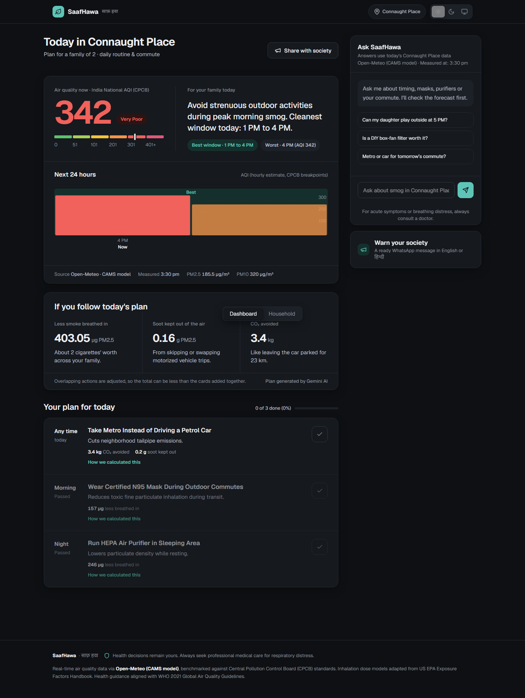
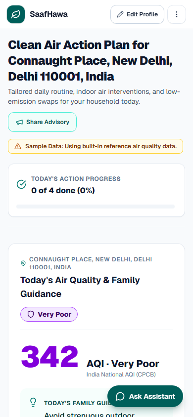
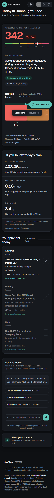
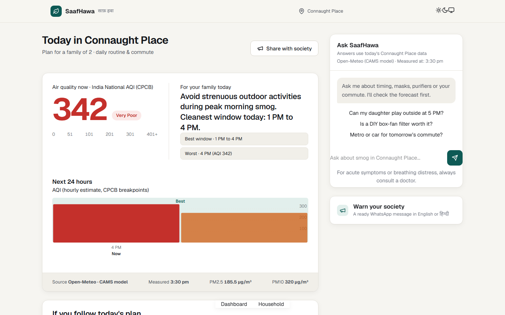

# SaafHawa (Clean Air Assistant) 🌫️🌱

Winter smog mitigation platform for households and communities. Combines real-time air quality data with living profiles to generate tailored 24-hour smog action plans, physical exposure and emission reduction arithmetic, conversational guidance via Gemini function calling, and WhatsApp community broadcast advisories.

- **Live Application:** [saafhawa-peach.vercel.app](https://saafhawa-peach.vercel.app)
- **Video Walkthrough (YouTube):** [youtu.be/VTisLQ5f-no](https://youtu.be/VTisLQ5f-no)

---

## 1. What It Does

During winter thermal inversions across South Asia, particulate matter (PM2.5) concentrates near ground level, pushing the Air Quality Index (AQI) into hazardous tiers. **SaafHawa** ("Clean Air") gives households and residential communities actionable interventions that reduce particulate inhalation and community emissions:

- **Tailored 24-Hour Smog Plan:** Onboards households through a 3-step profile (demographics, transit, home environment) and generates a daily timeline organized into time blocks (Morning, Afternoon, Evening, Night) and unconstrained actions ("Any time today").
- **24-Hour Forecast & Best Window:** Displays a rolling 24-hour forecast curve marking the current hour and highlighting the cleanest window of the day for ventilation or outdoor tasks.
- **Physical Exposure & Emission Math:** Computes personal PM2.5 inhaled dose avoided ($\mu\text{g}$) and community emissions prevented ($\text{g}$ PM2.5, $\text{g}$ $\text{CO}_2$) using published environmental models (CPCB, ARAI, EPA, WHO).
- **Conversational Assistant:** Follow-up chat assistant grounded with native tool calling to query live sensor readings and calculate action impact before answering.
- **WhatsApp Community Advisories:** One-click bilingual (English/Hindi) broadcast advisories for housing societies and parent groups.

---

## 2. Architecture Summary

SaafHawa separates cognitive selection from physical calculations:

1. **Deterministic Calculation Boundary:** Gemini selects qualitative actions and provides personalized context, while pure TypeScript arithmetic in `src/lib/impact/` calculates all exposure and emission savings without LLM hallucinations.
2. **Keyless Default with Transparent Upgrades:** Operates fully without API keys using free Open-Meteo Copernicus CAMS data and rule-based planning. When keys are present, it upgrades to official CPCB ground stations (WAQI), Google Air Quality, and Gemini models.
3. **Resilient Model Chains:** Evaluates an ordered list of models from `GEMINI_MODELS`, automatically tracking daily quota exhaustion, skipping depleted models, and falling back to deterministic planning.

Detailed module topology, component trees, and end-to-end request flows are documented in [**`docs/ARCHITECTURE.md`**](docs/ARCHITECTURE.md). Architectural design decisions and trade-offs are recorded in [**`docs/DECISIONS.md`**](docs/DECISIONS.md).

---

## 3. How Generative AI Is Used

SaafHawa integrates Google Gemini via `@google/genai` (v1beta API) with specific functional boundaries:

- **Action Selection & Timing:** Given household demographics and hourly AQI forecasts, Gemini selects 6–8 prioritized actions from a 26-action catalogue and assigns timing and family-specific rationales. Negative constraints prohibit Gemini from inventing or altering numbers.
- **Multi-Turn Function Calling:** In the follow-up chat assistant, Gemini receives tool definitions (`getAirQualityAndForecast`, `calculateActionImpact`). When users ask questions like _"Can my daughter play outside at 5 PM?"_, the model executes the tool, receives live hourly forecast observations, and answers with grounded context.
- **Bilingual Community Advisories:** Generates audience-tailored WhatsApp messages (housing societies, schools) in English and Hindi.
- **Model Fallback Chain:** Configured via `GEMINI_MODELS` (e.g. `gemini-flash-lite-latest,gemini-2.5-flash-lite,gemini-3.8-flash`). If upstream services return quota exhaustion (HTTP 429) or are unreachable, the system transparently falls back to rule-based generation with honest UI notices.

---

## 4. Data Sources & Telemetry Hierarchy

Air quality telemetry is resolved through a three-tier hierarchy:

1. **Tier 1 — CPCB Ground Stations (WAQI):** When `WAQI_TOKEN` is configured, queries the nearest official continuous ambient air quality monitoring station (CAAQMS) for hyper-local street-level readings.
2. **Tier 2 — Google Air Quality API:** When `GOOGLE_MAPS_API_KEY` is configured, queries Google's multi-layered machine learning model combining monitors, traffic, and satellite data.
3. **Tier 3 — Open-Meteo & Nominatim (Keyless Default):** When no keys are set, queries the European Copernicus CAMS chemical transport model (10–40 km grid) and OpenStreetMap Nominatim reverse geocoding with Indian PIN code resolution (`postalpincode.in`).
4. **Official CPCB AQI Calculation:** Piecewise linear interpolation converts pollutant concentrations to the official Indian National Air Quality Index.

Every screen identifies the active data source and measurement timestamp.

---

## 5. Problem Statement Traceability Matrix

| Requirement / Problem Statement Area                               | Implementation File(s)                                                                                                                                                         | Verifying Automated Test(s)                                                                                                                                                      |
| :----------------------------------------------------------------- | :----------------------------------------------------------------------------------------------------------------------------------------------------------------------------- | :------------------------------------------------------------------------------------------------------------------------------------------------------------------------------- |
| **India Local AQI (`ind_cpcb`) Priority**                          | [`src/lib/air-quality/index-extractor.ts`](src/lib/air-quality/index-extractor.ts)                                                                                             | [`src/test/air-quality-cache-index.test.ts`](src/test/air-quality-cache-index.test.ts)                                                                                           |
| **Null AQI on Missing Data (Never 0)**                             | [`src/lib/air-quality/index-extractor.ts`](src/lib/air-quality/index-extractor.ts)                                                                                             | [`src/test/air-quality-cache-index.test.ts`](src/test/air-quality-cache-index.test.ts)                                                                                           |
| **24-Hour Forecast & Resilient Fallback**                          | [`src/lib/air-quality/forecast-period.ts`](src/lib/air-quality/forecast-period.ts), [`src/lib/air-quality/service.ts`](src/lib/air-quality/service.ts)                         | [`src/test/air-quality-cpcb-report.test.ts`](src/test/air-quality-cpcb-report.test.ts)                                                                                           |
| **Error Handling (429/503) Without Leaks**                         | [`src/lib/air-quality/google-client.ts`](src/lib/air-quality/google-client.ts), [`src/lib/api/responses.ts`](src/lib/api/responses.ts)                                         | [`src/test/air-quality-route.test.ts`](src/test/air-quality-route.test.ts), [`src/test/api-error-boundaries.test.ts`](src/test/api-error-boundaries.test.ts)                     |
| **Single `place` Param, 120-Char Cap**                             | [`src/lib/air-quality/cache.ts`](src/lib/air-quality/cache.ts), [`src/app/api/air-quality/route.ts`](src/app/api/air-quality/route.ts)                                         | [`src/test/air-quality-route.test.ts`](src/test/air-quality-route.test.ts)                                                                                                       |
| **Action Catalogue (Routine, Indoor, Swaps)**                      | [`src/lib/impact/catalogue.ts`](src/lib/impact/catalogue.ts)                                                                                                                   | [`src/test/impact-catalogue.test.ts`](src/test/impact-catalogue.test.ts)                                                                                                         |
| **Pure Arithmetic: Dose ($\mu\text{g}$) & Emissions ($\text{g}$)** | [`src/lib/impact/calculator.ts`](src/lib/impact/calculator.ts), [`src/lib/impact/commute-swaps.ts`](src/lib/impact/commute-swaps.ts)                                           | [`src/test/impact-corrections.test.ts`](src/test/impact-corrections.test.ts), [`src/test/impact-edge-cases.test.ts`](src/test/impact-edge-cases.test.ts)                         |
| **Literature Citations & Physical Factors**                        | [`src/lib/impact/emission-factors.ts`](src/lib/impact/emission-factors.ts), [`src/lib/impact/exposure-factors.ts`](src/lib/impact/exposure-factors.ts)                         | [`src/test/impact-catalogue.test.ts`](src/test/impact-catalogue.test.ts)                                                                                                         |
| **Edge Cases: No Car, Clean Air ($5\,\mu\text{g}/\text{m}^3$)**    | [`src/lib/impact/calculator.ts`](src/lib/impact/calculator.ts)                                                                                                                 | [`src/test/impact-edge-cases.test.ts`](src/test/impact-edge-cases.test.ts)                                                                                                       |
| **POST /api/plan with Zod Validation**                             | [`src/lib/plan/types.ts`](src/lib/plan/types.ts), [`src/app/api/plan/route.ts`](src/app/api/plan/route.ts)                                                                     | [`src/test/plan-validation.test.ts`](src/test/plan-validation.test.ts)                                                                                                           |
| **Gemini JSON Selection (No Invented Numbers)**                    | [`src/lib/plan/service.ts`](src/lib/plan/service.ts), [`src/lib/plan/prompt-builder.ts`](src/lib/plan/prompt-builder.ts)                                                       | [`src/test/plan-validation.test.ts`](src/test/plan-validation.test.ts), [`src/test/plan-generation.test.ts`](src/test/plan-generation.test.ts)                                   |
| **Drop Invalid IDs & Rule-Based Fallback**                         | [`src/lib/plan/service.ts`](src/lib/plan/service.ts), [`src/lib/plan/fallback.ts`](src/lib/plan/fallback.ts)                                                                   | [`src/test/plan-generation.test.ts`](src/test/plan-generation.test.ts), [`src/test/rule-fallback.test.ts`](src/test/rule-fallback.test.ts)                                       |
| **Onboarding Wizard & Local Storage**                              | [`src/components/OnboardingForm.tsx`](src/components/OnboardingForm.tsx), [`src/app/page.tsx`](src/app/page.tsx)                                                               | [`src/test/components-form.test.tsx`](src/test/components-form.test.tsx), [`src/test/usability-onboarding.test.tsx`](src/test/usability-onboarding.test.tsx)                     |
| **Dashboard: Cards, Timeline, Progress**                           | [`src/components/PlanDashboard.tsx`](src/components/PlanDashboard.tsx), [`src/components/dashboard/DailyTimeline.tsx`](src/components/dashboard/DailyTimeline.tsx)             | [`src/test/components-cards.test.tsx`](src/test/components-cards.test.tsx), [`src/test/daily-timeline.test.ts`](src/test/daily-timeline.test.ts)                                 |
| **Accessibility: Semantic HTML, Contrast, Trap**                   | [`src/lib/use-focus-trap.ts`](src/lib/use-focus-trap.ts), [`src/components/ViewSwitch.tsx`](src/components/ViewSwitch.tsx)                                                     | [`src/test/components-advisory-dialog.test.tsx`](src/test/components-advisory-dialog.test.tsx), [`src/test/use-focus-trap.test.tsx`](src/test/use-focus-trap.test.tsx)           |
| **Chat with Function Calling & Disclaimer**                        | [`src/components/ChatPanel.tsx`](src/components/ChatPanel.tsx), [`src/lib/chat/service.ts`](src/lib/chat/service.ts), [`src/lib/chat/tools.ts`](src/lib/chat/tools.ts)         | [`src/test/chat-tools-exec.test.ts`](src/test/chat-tools-exec.test.ts), [`src/test/chat-multi-turn.test.ts`](src/test/chat-multi-turn.test.ts)                                   |
| **WhatsApp Community Advisory Modal**                              | [`src/components/CommunityAdvisoryModal.tsx`](src/components/CommunityAdvisoryModal.tsx), [`src/lib/community/advisory-generator.ts`](src/lib/community/advisory-generator.ts) | [`src/test/components-advisory-dialog.test.tsx`](src/test/components-advisory-dialog.test.tsx), [`src/test/advisory-coordinates.test.ts`](src/test/advisory-coordinates.test.ts) |
| **Rate Limiting & 64 KB Payload Caps**                             | [`src/lib/rate-limit.ts`](src/lib/rate-limit.ts), [`src/lib/security.ts`](src/lib/security.ts)                                                                                 | [`src/test/security.test.ts`](src/test/security.test.ts), [`src/test/content-type-protection.test.ts`](src/test/content-type-protection.test.ts)                                 |
| **Free Real-Time Open-Meteo Default**                              | [`src/lib/air-quality/open-meteo-client.ts`](src/lib/air-quality/open-meteo-client.ts)                                                                                         | [`src/test/air-quality-service.test.ts`](src/test/air-quality-service.test.ts), [`src/test/live-evaluator-queries.test.ts`](src/test/live-evaluator-queries.test.ts)             |
| **Official CPCB Piecewise AQI Calculation**                        | [`src/lib/air-quality/cpcb-aqi.ts`](src/lib/air-quality/cpcb-aqi.ts)                                                                                                           | [`src/test/cpcb-aqi.test.ts`](src/test/cpcb-aqi.test.ts)                                                                                                                         |
| **Indian PIN Code Resolution**                                     | [`src/lib/air-quality/pincode-resolver.ts`](src/lib/air-quality/pincode-resolver.ts)                                                                                           | [`src/test/air-quality-service.test.ts`](src/test/air-quality-service.test.ts)                                                                                                   |
| **Plan Consistency: Mutual Exclusivity**                           | [`src/lib/plan/conflict-resolver.ts`](src/lib/plan/conflict-resolver.ts)                                                                                                       | [`src/test/plan-consistency.test.ts`](src/test/plan-consistency.test.ts)                                                                                                         |
| **Trusted Proxy Hops (`TRUSTED_PROXY_HOPS`)**                      | [`src/lib/rate-limit.ts`](src/lib/rate-limit.ts)                                                                                                                               | [`src/test/rate-limit-proxy.test.ts`](src/test/rate-limit-proxy.test.ts)                                                                                                         |
| **Security Headers (CSP, COOP, CORP)**                             | [`src/lib/security.ts`](src/lib/security.ts), [`next.config.ts`](next.config.ts)                                                                                               | [`src/test/security.test.ts`](src/test/security.test.ts), [`e2e/modals-and-security.spec.ts`](e2e/modals-and-security.spec.ts)                                                   |

---

## 6. Setup & Local Development

### Prerequisites

- **Node.js**: `v20.x` or `v22.x` (LTS)
- **npm**: `v10.x` or higher

### Installation & Run

```bash
git clone https://github.com/sirajju/saafhawa.git
cd saafhawa
npm install
npm run dev
```

Open [http://localhost:3000](http://localhost:3000) in your browser.

---

## 7. Environment Variables

Copy the example file to configure credentials (all variables are optional):

```bash
cp .env.example .env.local
```

| Variable                | Required? | Default / Example                                                 | Purpose                                                              |
| :---------------------- | :-------- | :---------------------------------------------------------------- | :------------------------------------------------------------------- |
| `GEMINI_API_KEY`        | Optional  | `AIzaSy...`                                                       | Enables Gemini plan generation, chat tools, and advisory text.       |
| `GEMINI_MODELS`         | Optional  | `gemini-flash-lite-latest,gemini-2.5-flash-lite,gemini-3.8-flash` | Ordered list of models tried in sequence, skipping exhausted quotas. |
| `GEMINI_MODEL`          | Optional  | `gemini-flash-lite-latest`                                        | Backwards-compatible primary model ID.                               |
| `GEMINI_FALLBACK_MODEL` | Optional  | `gemini-2.5-flash-lite`                                           | Backwards-compatible fallback model ID.                              |
| `GOOGLE_MAPS_API_KEY`   | Optional  | `AIzaSy...`                                                       | Upgrades telemetry to Tier 2 Google Air Quality API.                 |
| `WAQI_TOKEN`            | Optional  | `your_waqi_token`                                                 | Upgrades telemetry to Tier 1 CPCB ground monitoring stations.        |
| `TRUSTED_PROXY_HOPS`    | Optional  | `1`                                                               | Number of trusted reverse proxy hops for client IP extraction.       |

---

## 8. Verification & Testing

```bash
# Full verification pipeline: lint, typecheck, tests, and formatting
npm run check

# Run unit and integration tests with coverage
npm run test:coverage

# Run live network integration test (evaluator cities)
npm run test:live

# Run Playwright end-to-end browser tests
npm run test:e2e

# Build production bundle
npm run build
```

---

## 9. Interface Showcase

|                            Desktop View (Light Mode)                             |                            Desktop View (Dark Mode)                            |
| :------------------------------------------------------------------------------: | :----------------------------------------------------------------------------: |
|  |  |

|                            Mobile View (Light Mode)                            |                           Mobile View (Dark Mode)                            |
| :----------------------------------------------------------------------------: | :--------------------------------------------------------------------------: |
|  |  |

|                     Conversational Assistant (Desktop)                     |               WhatsApp Advisory Broadcast Modal                |
| :------------------------------------------------------------------------: | :------------------------------------------------------------: |
|  |  |

---

## 10. How This Was Built with AI

### AI Tools & Engineering Roles

- **Google Antigravity:** Primary agentic coding assistant translating specifications into TypeScript, maintaining modular boundaries (under 200 lines per file), running automated verification, and coordinating refactoring passes.
- **Google Gemini (In-App Runtime AI):** Runtime model via `@google/genai` (v1beta API). Powers structured action selection and context-aware function calling in the conversational assistant.
- **Claude Code:** External audits, adversarial security reviews, and test design verification.

### Prompt Evolution & Iterative Engineering

1. **Deterministic Foundation:** Defined mass-balance arithmetic, CPCB breakpoints, and Zod schemas to keep AI output bounded.
2. **Quality & Resilience:** Implemented sliding-window rate limiters, 64 KB payload boundaries, trusted proxy hops, and multi-model fallback chains.
3. **Calm Health UX:** Transformed dense inputs into a 3-step wizard with choice chips, an SVG 24-hour forecast curve, clean timeline groupings, and isolated AQI category tokens.
4. **Field Hardening:** Integrated server-side Nominatim reverse geocoding, Gemini daily quota tracking, and transparent fallback notices.

### Division of Labor

- **Human Author:** Problem definition, calm health UX principles, environmental health benchmarks, testing across Indian cities, security reviews, and architectural trade-offs.
- **Generative AI:** Component and service implementation, design tokens, unit and integration test authoring, Playwright scenario generation, and accessibility compliance.

---

## 11. Documentation Index

- 🏗️ [`docs/ARCHITECTURE.md`](docs/ARCHITECTURE.md) — Architectural topology, module map, and request flows.
- 📐 [`docs/DECISIONS.md`](docs/DECISIONS.md) — Architectural design decision records and trade-offs.
- 🛡️ [`SECURITY.md`](SECURITY.md) — Threat models, CSP, 64 KB caps, rate limiters, and proxy configurations.
- ♿ [`docs/ACCESSIBILITY.md`](docs/ACCESSIBILITY.md) — Semantic landmarks, keyboard navigation, contrast, and focus management.
- 🧪 [`docs/TESTING.md`](docs/TESTING.md) — Test suites, coverage summaries, and live network testing.
- ⚡ [`docs/EFFICIENCY.md`](docs/EFFICIENCY.md) — Build asset measurements, standalone packaging, and cache bounds.

---

## License

This project is licensed under the MIT License — see the [`LICENSE`](LICENSE) file for details.
