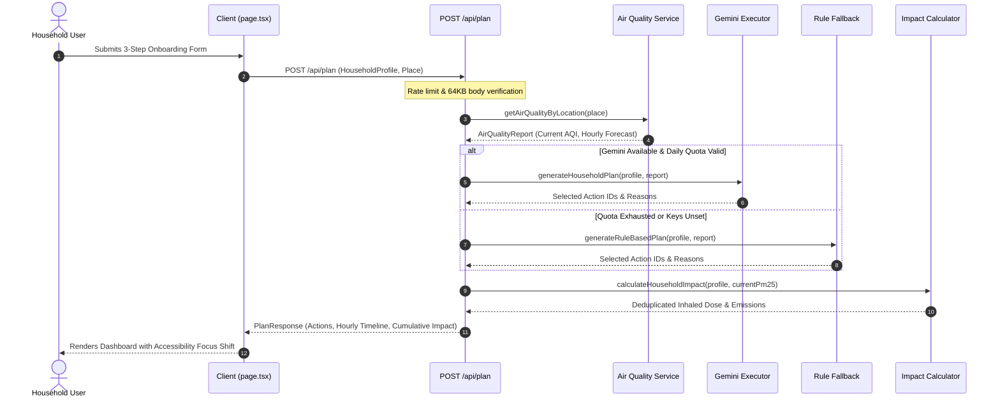
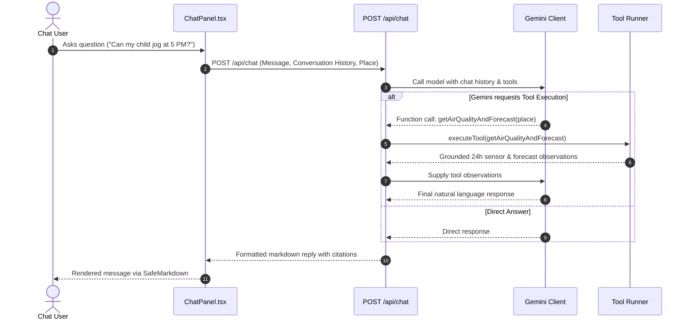
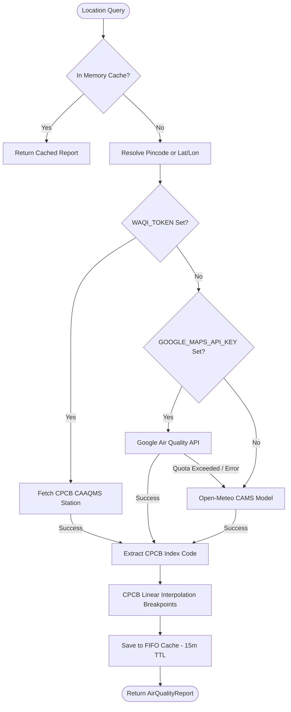

# SaafHawa Architecture & System Design

This document details the architectural topology, module organization, and end-to-end request flows of **SaafHawa (साफ़ हवा)**.

---

## 1. Architectural Principles

1. **Deterministic Arithmetic Boundary:** Pure physical arithmetic (inhaled dose avoided in $\mu\text{g}$, emissions saved in $\text{g}$) is computed strictly by deterministic TypeScript mathematical models in [`../src/lib/impact/`](../src/lib/impact/). Gemini selects qualitative actions and provides personalized context, but never outputs or computes numbers.
2. **Keyless-First Zero-Setup Default:** The app operates fully out-of-the-box without requiring paid API credentials. If `GEMINI_API_KEY`, `GOOGLE_MAPS_API_KEY`, or `WAQI_TOKEN` are absent or exhausted, the system seamlessly uses keyless Open-Meteo Copernicus CAMS data and rule-based planning algorithms.
3. **Multi-Model Quota Resilience:** The Gemini client cycles through candidate models in `GEMINI_MODELS` with automatic daily quota exhaustion detection, skipping exhausted models and falling back to rule-based generation when limits are reached.
4. **Defense in Depth:** Public routes enforce in-memory sliding-window rate limiting, 64 KB JSON payload boundaries, content-type checks, and strict CSP security headers.

---

## 2. Module Map

```
src/
├── app/                           # Next.js 16 App Router
│   ├── api/                       # API route handlers
│   │   ├── air-quality/route.ts   # Current AQI & 24h hourly forecast endpoint
│   │   ├── chat/route.ts          # Multi-turn assistant with function calling
│   │   ├── community-advisory/    # WhatsApp broadcast advisory generator
│   │   ├── plan/route.ts          # Household plan generation endpoint
│   │   └── reverse-geocode/       # Nominatim reverse geocoding with cache
│   ├── styles/                    # Modularized CSS stylesheets (<= 200 lines each)
│   ├── layout.tsx                 # Root layout with metadata and fonts
│   └── page.tsx                   # Client state orchestrator (onboarding & dashboard)
├── components/                    # Accessible UI component library
│   ├── chat/                      # ChatPanel, ChatHeader, ChatMessageList, SafeMarkdown
│   ├── dashboard/                 # DailyTimeline, DailyTimelineItem, DashboardHeader
│   ├── forecast/                  # ForecastChart, ForecastChartSvg
│   ├── onboarding/                # 3-step onboarding form & habit pickers
│   └── ui/                        # Icons, ErrorState, ViewSwitch
├── lib/                           # Core business logic & domain services
│   ├── air-quality/               # Telemetry fetching, CPCB breakpoints & caching
│   ├── api/                       # Shared API error handling & response helpers
│   ├── chat/                      # Assistant prompt engineering, tools & runner
│   ├── community/                 # Advisory templates, schemas & generator
│   ├── gemini/                    # Model chain executor, quota tracker & cache
│   ├── impact/                    # Pure deterministic exposure & emissions physics
│   ├── plan/                      # Plan generation, scoring, conflicts & fallback
│   ├── env.ts                     # Single validated environment parser
│   ├── rate-limit.ts              # In-memory sliding-window IP rate limiter
│   ├── security.ts                # Security headers, CSP & payload limiters
│   └── use-focus-trap.ts          # Accessible keyboard focus trap hook
└── test/                          # Unit and integration test suites
```

---

## 3. End-to-End Request Flows

### 3.1 Household Plan Generation Flow (`POST /api/plan`)



---

### 3.2 Conversational Assistant Flow (`POST /api/chat`)



---

### 3.3 Air Quality Telemetry Resolution Flow


